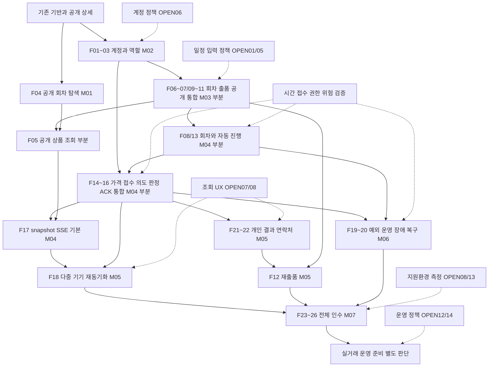

# MVP 개발 로드맵

- 상태: **USER_APPROVED / 로드맵과 첫 M-01 실행 범위 승인**, 버전 1.0, 2026-10-16. 책임: Project Planning Lead.
- 승인 근거: 사용자가 `49bec92cc33e8a61dc5fa5d3f6c7c84432f78d7d`의 0.1 로드맵·백로그 및 M-01 첫 실행 범위 제시에 **“승인”**으로 답했다. 범위/순서/DoD를 유지하고 승인 상태와 인계 링크만 반영했다.
- 대상: 승인된 G-01, R-01~R-52, EX-01~EX-10 및 AC 136개 전체. Feature 목록·추적 책임은 [BACKLOG](BACKLOG.md).
- 조사 기준: fetch로 확인한 `origin/dev = a8d4df69c891f0f55fd017f20a2f427f27367de6`, 최초 작업 트리 clean. 실제 구현 착수 SHA가 아니다.
- 이번 산출물은 승인된 개발 순서·의존성·완료 관문이다. 제품 정책·계약 변경, 실제 구현 시작, 기술 위험 해소, 릴리스 완료를 뜻하지 않는다. 미정 CR/SEC·deferred 표면은 별도 결정 대상이다.
- 별도 실행 세션의 진입점은 **[M-01 실행 리드 컨텍스트](handoffs/M-01-LEAD-CONTEXT.md)**다. 범위 재승인 없이 실제 READY 조건을 확인하며, 이 계획 세션에서는 구현을 시작하지 않았다.

## 1. 기준선과 현재 출발점

| 기준 | 현재 입력과 사용 원칙 |
| --- | --- |
| 제품 | [MVP-PRD 1.6](product/MVP-PRD.md), [AUCTION-RULES 1.6](product/AUCTION-RULES.md). 요구사항·AC·제외 범위의 원본 |
| 도메인·구조 | [DOMAIN-MODEL 1.2](architecture/DOMAIN-MODEL.md), [SYSTEM-DESIGN 1.0](architecture/SYSTEM-DESIGN.md), [모듈 경계](../backend/MODULE-BOUNDARIES.md) |
| 결정 | [DECISION-LOG 1.8](decisions/DECISION-LOG.md), [ADR-001~005](decisions/adr/README.md). D-095의 채택 범위와 잔여 OPEN을 함께 적용 |
| 계약 | [OpenAPI](../contracts/openapi.yaml), [이벤트 의미](../contracts/auction-events.md), [승인 manifest](../contracts/approved-baseline-0.1.0.json), 계약 0.1.0. 의미 변경은 [ADR-005](decisions/adr/ADR-005-CONTRACT-BASELINE.md) |
| 실행 계획·상태 | [IMPLEMENTATION-PLAN 0.5](implementation/IMPLEMENTATION-PLAN.md), [QA-PLAN](implementation/QA-PLAN.md), [STATE](STATE.md), [기존 M-01 DRAFT](tasks/README.md) |
| 이번 문서 검토 | [ROADMAP-REVIEW](implementation/ROADMAP-REVIEW-2026-10-16.md). 정적 검토와 제품 실행 증거 구분 |

현재 채택 스택은 Corretto 25, Spring Boot 4.1.1, Gradle Wrapper 9.8.1, Spring MVC/JDBC, PostgreSQL, React/TypeScript다. 단일 앱·단일 활성 진행 주체·권위 PostgreSQL과 REST/SSE는 승인된 구조다. 실제 전이 시각·내구 접수·진행 중 트랜잭션의 확정 권한은 이 구조 안에서 여전히 구현·검증해야 한다. 오래된 SPIKE의 후보 상태를 현재 기술 미채택으로 해석하지 않고, 설계 채택을 실험·제품 검증 성공으로 해석하지도 않는다.

| 현재 범위 | 관측과 활용 |
| --- | --- |
| 개발 기반 | 승인 guard, 생성 타입, BE/FE 빌드·경계 검사, disposable DB/브라우저 runner, CI 존재. 새 기능의 자동 PASS 근거는 아님 |
| 공개 회차 상세 | PostgreSQL → REST → React 구현. 검증 구현 SHA `39fb9e147c6e9b04dc5f763f164b6e2c349c4dca`, [과거 실행 보고서](implementation/PUBLIC-ROUND-VERIFICATION.md). M-01 회귀 대상으로 재사용 |
| 공개 회차 목록 | 미구현. 첫 화면은 상세 링크 안내. T-001~004는 DRAFT이며 실제 구현 시작 기록 없음 |
| 인증·출품·입찰·자동 진행·SSE | 제품 구현 및 실행 검증 NOT_RUN. 개발 fixture·계약 예제·SPIKE로 대체하지 않음 |
| 운영 배포 | NOT_RUN. dev 통합·CI 성공은 RELEASED가 아님 |

과거 DB 장애 검증은 DB 복귀 뒤 **새 조회**의 성공이다. 열린 오류 화면 재시도·세션 복구·입찰 원기록·SSE 복구 증거로 확대하지 않는다. 이번 계획 세션은 소스·문서·기존 증거를 조사했으며 로컬 앱/DB/브라우저를 재실행하지 않았다.

## 2. 우선순위와 순서의 근거

모든 승인 기능은 MVP 필수다. [BACKLOG](BACKLOG.md)의 P0/P1/P2는 구현·검증 순서이며 범위 삭제나 선택 기능 표시가 아니다.

1. **작은 실제 흐름을 먼저 닫는다.** M-01은 승인 계약과 기존 상세를 이용해 탐색→상세→오류 복구를 검증할 수 있다. 인증 정책 결정을 모든 진입 작업의 선행조건으로 만들지 않는다.
2. **사용자와 공급을 먼저 준비한다.** M-02 계정·권한이 M-03 실제 출품과 운영 설정의 전제다. 회차·출품을 fixture로만 만드는 상태를 전체 경매 완료로 삼지 않는다.
3. **고위험 검증은 앞당긴다.** M-02~03에서 시각·접수·권한 검증 설계를 병행하고 M-04의 해당 흐름 완료 전에 필요한 증거를 확보한다. 복구 UI가 뒤에 있다고 안전 경계를 뒤로 미루지 않는다.
4. **실제 경쟁을 중간 검증점으로 둔다.** M-04에서 1~4레인 자동 진행과 두 구매자의 경쟁·원판정 확인을 연결한다. 정상 경매만 통과한 것을 R-21/23/24/26 전체 완료로 올리지 않는다.
5. **개인 복원과 운영 복구는 서로 다른 흐름으로 완성한다.** M-05는 개인 연결·기기·거래 인계, M-06은 서비스 장애·운영 제어를 책임진다. 준비는 병렬화하되 공유 경매 상태 변경은 한 소유자가 통합한다.
6. **통합 품질은 마지막에 수집만 하는 일이 아니다.** 권한·브라우저·정합성 검증은 기능마다 수행한다. M-07에서 합의한 환경의 전체 AC·부하·운영 경계를 종합 인수한다.

달력 날짜·인일은 아직 약속하지 않는다. 인력 가용 시간과 M-01 실제 처리량이 없고 M-04/06은 검증 결과에 따라 재설계가 가능하다. 아래 크기는 상대 범위일 뿐 기간 추정이 아니다. M-01 종료 때 다음 두 마일스톤의 가용 인력·관측 속도·정책 대기 시간을 바탕으로 일정 범위를 갱신한다. 먼 마일스톤은 Feature 수준을 유지한다.

## 3. 전체 마일스톤

| 단계 | 사용자가 확인할 결과 | 주요 Feature | 완료 선행 | 상대 범위 / 예측 신뢰 |
| --- | --- | --- | --- | --- |
| 현재 기반 | 공개 회차 상세 조회와 개발 검증 기반 | F04 일부, F23/F26 기반 | 기존 증거 | 완료된 부분만 재사용 |
| M-01 공개 회차 탐색 | 첫 화면→목록/다음 페이지→상세→복귀·재시도 | F04 | 로드맵·범위 승인 | 작음 / 높음 |
| M-02 계정과 역할 | 이메일 검증 가입→로그인→로그아웃·재설정, 운영 계정 분리 | F01~03, F23 | M-01 통합, 계정 정책 결정 | 중간 / 정책 결정 전 낮음 |
| M-03 회차와 출품 공개 | 운영자 설정→회원 출품/수정→배정→공개 상품 확인 | F05/06/07/09/10/11/21 일부 | M-02, 입력·일정 정책 | 큼 / 중간 |
| M-04 정상 경쟁 경매 | 자동 시작→4레인 독립 경쟁→원판정 확인→결과·다음 상품/회차 | F08/13~17, F19/20 안전 경계 | M-03, 시간·접수·권한 관문 | 매우 큼 / 낮음 |
| M-05 개인 복원과 거래 인계 | 재연결/다른 기기에서 원입찰 복원→내 결과→상대 이메일·재출품 | F05/12/16~18/21/22 | M-04, 조회·UX 정책 | 큼 / 중간 |
| M-06 예외 운영과 장애 복구 | 운영자 중단/취소→기록 확인→명시적 재개, 장애 시 보류·복구 | F08/11/15/16/19/20 | M-04의 안전 경계, 복구 증거 | 매우 큼 / 낮음 |
| M-07 전체 MVP 인수 | PC 전체·모바일 회원 전 과정과 4레인/100연결·정확성 증거 | F23~26 및 전체 회귀 | M-05와 M-06 통합 | 큼 / 측정 합의 전 낮음 |

M-02 정책 검토는 M-01 중에, M-03 입력 정책 검토와 M-04 위험 검증 설계는 M-02 중에 시작할 수 있다. M-05와 M-06은 M-04 뒤 병렬 준비가 가능하다. 위 완료 선행은 **실제 사용자 흐름을 인수할 조건**이며 계약 기반 화면·독립 기대값·격리 기술 검토까지 모두 직렬화하는 뜻이 아니다.

### M-01 — 공개 회차 탐색

**흐름:** 비회원이 첫 화면에서 공개 목록과 다음 페이지를 보고 상세를 선택한 뒤 목록으로 돌아온다. DB 장애를 구별하고 같은 오류 화면에서 재시도하여 복구한다.

- 기존 [M-01 운영안과 T-001~004](tasks/README.md)를 재사용한다. 새 기능 Task를 중복 작성하지 않는다.
- 완료: 공개 사실·정렬·cursor·마지막/빈 페이지를 실제 PostgreSQL/HTTP로 확인하고 미공개·개인 필드를 노출하지 않는다. opaque ID, 큰 counter, 시각의 원표현을 보존한다.
- 완료: 실제 목록→상세→복귀, 503 표시와 **동일 열린 화면의 성공 재시도**, 기존 상세 회귀를 같은 빌드에서 관측한다. 지정 SHA 검증·독립 검토·CI·dev 통합을 기록한다.
- 경계: R-37의 탐색 부분이다. 상품 상세·실시간·출품·인증은 아직 없으므로 R-37 전체 PASS가 아니다. Chromium 1280/390은 제안한 개발 관측 조건이며 전체 R-47 인수가 아니다.

### M-02 — 계정과 역할

**흐름:** 방문자가 검증 이메일로 가입을 완료하고 로그인·세션 확인·로그아웃한다. 재설정 이메일을 통해 비밀번호를 바꾸고 새 비밀번호로 로그인한다. 사전 지정 운영자는 운영 전용 권한으로 접근한다.

- 시작: OPEN-06/CR-10/SEC-01~04 중 실제 경로에 필요한 계정 동일성·비밀번호·토큰/세션·재설정·운영자 준비 정책을 승인하고 필요한 계약 변경을 봉인한다. 후보 수치를 기본값으로 채우지 않는다.
- 완료: 실제 세션/행위자와 보안 경계에서 검증 전 회원 자격 미부여, 일반 가입의 운영 권한 취득 불가, 운영 전용 역할과 일반회원 역할 분리를 검사한다. 아직 없는 출품/입찰/개인목록/연락처 API의 권한 검사를 완료했다고 기록하지 않으며 해당 기능 통합 때 실제 행위 반례로 마감한다.
- 완료: 실제 PostgreSQL·세션·쿠키/CSRF, 메일 전달 경로, 만료·재사용·동시 사용·메일 실패·로그아웃/재설정의 승인된 무효화 조건을 확인한다. 로컬 메일 수신함 증거와 외부 메일 운영 증거를 구분한다.
- 완료: PC와 개발용 모바일에서 가입→검증→로그인→재설정 흐름을 수행하고 비밀이 응답 외 로그·URL·시험 증거로 유출되지 않는지 확인한다. 브라우저 지원의 최종 인수는 M-07이다.
- 후속: 세션 만료/재설정이 경매 원기록·미확인 제한을 삭제하지 않는 통합 회귀는 M-05/06에서 추가한다. 아직 입찰 권한 집행 전체를 검증했다고 하지 않는다.

### M-03 — 회차와 출품 공개

**흐름:** 운영자가 일정·1~4레인·시간을 설정한다. 회원은 모집 중 회차에 사진·설명·가격을 제출하여 자동 배정받고 허용 기간에 수정·취소한다. 공개 시 비회원이 고정된 상품 목록·사진·상세를 본다.

- 시작: OPEN-01/05의 일정·입력 제한과 단위 후보를 결정한다. 후보 제공에 필요한 `listing-options`의 deferred 계약은 사용자 결정과 ADR-005를 거쳐 완성한다.
- 완료: 모집 비중복, 현재≤모집 시작<공개<예약 시작, 전날 00:00 서울 시각, 모집 시작 포함·마감 제외, 진행 회차와 미래 모집의 분리를 실제 DB에서 확인한다.
- 완료: 공식 출품 순번·최소 대기 수·작은 레인 동률·무효 등록·동시 등록, 수정/취소 시 원배치 유지, 레인 수 변경 때만 전체 재배정을 확인한다. 공개 직전 유효 변경을 반영한 뒤 배치를 고정한다.
- 완료: 필수 사진/가격과 소유권, 단위 후보/직접 입력, 비정렬 최저가 허용, 상품 심사 없음, 공개 후 수정 금지·번호/취소 자리 보존을 API와 화면에서 확인한다. 미공개 사진·최저가 원금액은 공개하지 않는다.
- 경계: 공개 후 출품자 취소의 **입찰 개시 직전/정각** 및 취소 상품 건너뛰기는 M-04, 운영 명령/장애와의 전체 경합은 M-06에서 마감한다. F11 전체를 M-03에서 완료 처리하지 않는다.

### M-04 — 정상 경쟁 경매

**흐름:** 운영자가 준비한 회차가 자동 시작한다. 출품자 1명·구매자 2명이 실제 상품을 두고 버튼 입찰하며, 비회원은 진행을 관람한다. 각 기기는 본인 원판정을 확인하고 공개 낙찰·유찰 결과를 본다. 다른 레인과 다음 상품·다음 회차가 각 조건대로 진행한다.

큰 통합 구간이므로 아래 **Feature 통합 관문 3개를 모두 통과**해야 완료다. 이는 세부 Task나 미래 클래스 구조 확정이 아니다.

| 관문 | 검증 가능한 완료 조건 |
| --- | --- |
| M04-A 자동 진행·회차 | 1·2·3·4레인 구성, 공통 실제 첫 준비 S, 이후 독립 준비 N, 기존 개시/마감 유지, 실제 시작 시 시간 고정, 예약순 단일 회차·지연 표시, 시작/회차 취소 공통 순서, 빈 레인/빈 회차와 마지막 레인 동시 완료를 실제 DB/HTTP로 확인 |
| M04-B 공식 접수·경쟁 | 공유 의도 등록 확인 뒤 실제 입찰, 내구 접수·원시각/순번, 동일 금액 경쟁, 정확한 버튼 금액·자격·거절 무변경, 마감 전/정각/후·옛 timer, 동일 키/내용 충돌·원최종 판정·앱 반영 후 ACK를 실제 세션/DB/HTTP에서 확인 |
| M04-C 공개 경험 | 실제 outbox→snapshot/SSE→브라우저 연결, 가격·단계·최저가 도달/최종 결과·본인 처리 확인 중의 구분, 4레인 독립성, 유찰 최고입찰가/최저가/개인정보 비노출, 낙찰/유찰 불변 및 다음 상품 진행을 관측 |

M04-B는 입찰과 출품자 취소·운영 중단/현재 상품 취소의 **공통 순서와 대상 고정**을 서버 수준에서 함께 검증한다. 운영자 PC 예외 흐름 전체는 M-06이지만 뒤늦게 별도 순서 체계를 덧붙이지 않는다. 서버의 회원×경매 단일 미확인 의도와 원키/ACK 의미는 M-04 필수이며 다중 기기 화면 완성까지 미루지 않는다.

**최소 안전 관문:** 개인 응답 유실·commit 응답 불명은 원키 조회/재전송과 회원×경매 미확인 제한으로 다루며 이것만으로 레인을 보류하지 않는다. 서비스 접수 연속성·권위 이력/효과·진행 권한이 불명하거나 장기 판정 지연이면 증거에 따라 해당 레인 또는 현재 회차 미완료 레인의 결과·진행을 보류한다. 어느 경우도 추정 거절/유찰로 바꾸지 않는다. 현재 구현에 해당하는 시간·old transaction·장애 선후 반례는 실제 장애 주입으로 확인한다. 이 관문의 FAIL 또는 NOT_RUN이면 M-04 완료가 아니라 **정상 경로 부분 검증**으로 남긴다. M-06은 전체 복구·재개 흐름을 완성하는 단계이며 기본 안전성 결함을 유예하는 단계가 아니다.

R-21의 재개 경합, R-23의 전체 다중 기기/재기동 복구, R-24~26의 종합 장애 사례는 아직 남는다. 성능 목표·운영 가용성·전체 경매 AC 완료를 주장하지 않는다.

### M-05 — 개인 복원과 거래 인계

**흐름:** 입찰자의 응답이 유실되거나 기기가 끊겨도 같은 원번호로 판정을 확인한다. 다른 기기가 그 판정을 수신·반영하면 해당 의도 제한이 해제된다. 회원은 내 출품·참여 결과에서 해당 상품과 낙찰 상대 이메일로 이동하고, 유찰 상품은 새 신청으로 재출품한다.

- 시작: OPEN-07의 낙찰자 표시 필드와 필요한 이력 범위, OPEN-08의 레인/종료 결과 UX를 결정한다. 승인된 낙찰자 식별 기능의 deferred `winner` 계약은 별도 승인 반영이 필요하다. 추가 운영자 개인정보 조회나 전체 입찰 분석 기능을 자동 추가하지 않는다.
- 완료: snapshot/replay/live 인계, 중복·역전·gap·마지막 이벤트 유실·세대 변경·느린 연결을 시험하여 현재 상태로 수렴한다. SSE 공개 상태 수신을 개인 판정 ACK나 경매 재개로 해석하지 않는다.
- 완료: 동시 의도 등록·등록 응답 유실/미도달·원요청 재전송·옛 ACK·상품 전환·재로그인/재설정의 다중 기기 사례에서 원경매/금액/판정과 미확인 범위가 유지된다. 기록 없음/timeout/경매 종료만으로 미확인을 해제하지 않는다.
- 완료: 본인 출품·참여/결과 목록, 당사자만의 검증 이메일 상호 제공, 허용된 낙찰자 식별, 제3자/유찰/취소의 연락처 차단을 실제 세션과 PC/모바일에서 확인한다. 유찰 결과에는 최고가가 없고 본인 원입찰은 유지된다.
- 완료: 유찰 후 모집 중 회차에 새로 신청하면 새 순서로 배정되고 옛 결과는 남는다. 자동 재출품·상품 복사·외부 거래 완료 추적을 추가하지 않는다.
- 경계: 서비스/DB 장애의 복원은 M-06과 합친 뒤 회귀한다. M-05의 개인 연결 복구만으로 장애 복구나 R-49 지연 목표를 통과시키지 않는다.

### M-06 — 예외 운영과 장애 복구

**흐름:** PC 운영자가 준비/최초/후속 단계의 레인을 중단하고 필요하면 현재 상품을 사유와 함께 취소한다. 장애 시 영향을 받는 진행만 보류되고, 운영자는 이력과 접수 가능 상태를 확인한 뒤 현재 중단 발생건을 명시하여 재개한다. 불명 이력은 계속 보류되며 후속 회차도 대기한다.

- 완료: 수동 중단·장애 보류의 독립 원인, 현재 상품 취소 후 진행/중단 상태, 원입찰/취소 사유, 확정 결과 불변을 실제 운영 UI와 API에서 확인한다.
- 완료: 원명령 중복/내용 충돌·원재개 R 유지·새 중단에 대한 옛 재개 차단, 실제 재개부터 단계 전체 시간, 재개 전/정각 입찰과 첫 유효 입찰의 후속 마감 갱신을 검증한다.
- 완료: 단일 레인/전체·영향 불명, 정상 마감 선행/장애 선행/선후 불명, 원판정 존재/완전 미결/효과 불명, DB 재시작·네트워크 단절·중복 앱 기동·권한 연결만 상실·진행 중 old tx를 구분한다. [ADR-001](decisions/adr/ADR-001-TRANSITION-TIME.md)의 TM-01~09와 [ADR-003](decisions/adr/ADR-003-FAILURE-AUTHORITY-AND-RECOVERY.md)의 FA-01~14 및 TV-04/08/10을 적용성·증거와 함께 마감한다.
- 완료: 복구 확인만으로 자동 재개하지 않고 보류 취소의 결과 없음·선행 이력 확인·사유 조건을 지킨다. 원기록·공개 상태·개인 미확인·후속 회차를 함께 회귀한다.
- 경계: 이력 불명은 성공적으로 **보류 유지**한 결과가 될 수 있다. `historyComplete=true` 덮어쓰기나 강제 유찰로 시험을 통과시키지 않는다. 별도 이력 복원관리 API·권한은 미정 후보이며 필요하면 ADR-005 검토를 요청한다. 자동 takeover·복수 active·DB failover 지원을 추가하지 않는다.

### M-07 — 전체 MVP 인수와 운영 전 판단

**흐름:** PC에서는 회원·운영자 전체, 모바일에서는 일반회원 전체 흐름을 수행한다. 출품자 1명과 구매자 2명의 출품→경쟁→결과→연락처, 4레인의 독립 진행·예외 복구, 100연결과 별도 집중 입찰을 재현하고 포트폴리오 증거로 설명한다.

- 시작: OPEN-08 지원 환경과 OPEN-13의 네트워크·빈도·기간·반복·집중 패턴·측정 경계·실패/시간초과 표본 처리를 승인한다. 조사 목적 측정과 제품 인수 시험을 구분한다.
- 완료: [BACKLOG](BACKLOG.md)의 G/R/EX 전체 및 SC-01~10을 정확한 commit·실행 명령·원시 artifact·독립 판정에 연결한다. 미실행 필수 AC나 미해결 FAIL이 있으면 전체 기능 인수 완료가 아니다.
- 완료: 4레인·100연결(20 입찰 역할/80 관람 역할)의 기본 부하와 별도 집중 부하에서 클릭→본인 판정 표시 p95≤1초, 권위 상태 확정→다른 화면 p95≤1초, 재연결→현재 상태 복원 p95≤3초, 정책과 다른 승인/거절·중복 효과·오낙찰 각각 0건을 검증한다. 100명을 가입자 상한으로 구현하지 않는다.
- 완료: 합의한 PC/모바일 실제 브라우저에서 사진 업로드·가입·재설정·출품·4레인 관람/입찰·본인 결과·연락처를 관측한다. PC 운영 흐름도 포함한다. HYP-01 기본 시간의 사용성·HYP-02 배정 편차는 관찰 결과로 남기고 임의로 정책을 변경하지 않는다.
- 완료: 개인정보·비밀 보호, 로그/관측, 배포·복원 절차의 대상 환경 증거와 결제/정산 확장 책임 경계 설명을 남긴다. 실제 거래를 하려면 OPEN-12/14와 운영 메일·보존/삭제·연락처 접근 종료·품목/분쟁 책임을 먼저 결정한다.

**판정은 분리한다:** `MVP 기능·인수 완료`는 합의된 시험 환경에서 전체 기능·품질 기준을 충족한 상태다. `실거래 운영 준비`는 OPEN-12/14와 실제 환경의 배포·보안·복원 증거가 더 필요하다. `RELEASED`는 별도 사용자 릴리스 승인과 배포 확인 뒤에만 기록한다. 이 로드맵 승인이나 dev 통합으로 main 승격·운영 배포를 수행하지 않는다.

## 4. 기능 의존성 그래프

화살표는 후행 기능의 **실제 통합 인수**에 필요한 선행 기능이다. 같은 마일스톤에서 함께 완성해야 하는 기능은 한 노드로 묶었고, 일부만 필요한 노드는 ‘부분’으로 표시했다. 점선은 정책/위험 검증 관문이다. F 번호의 의미·세부 선행은 [BACKLOG](BACKLOG.md)를 따른다.



주요 완료 경로는 **계정→회차/출품→공식 접수·자동 진행→개인 복원/운영 복구→전체 인수**다. M-01은 이 경로의 위험을 줄이는 작은 제품 진입 흐름이며 모든 기술 실험의 필수 선행은 아니다. F19/20의 공통 순서·보류 차단 부분은 C/A의 M-04 관문 안에서 먼저 통합한다. 그래프의 M-06 노드는 나머지 사용자 복구 흐름 완성을 뜻한다.

## 5. 병렬화와 통합 책임

| 구간 | 병렬로 할 수 있는 일 | 합쳐서 확인할 지점 |
| --- | --- | --- |
| M-01 | BE 목록 API와 FE 계약 mock. QA 독립 기대값 읽기 검토 | BE 통합 SHA→FE 실제 연결→독립 DB/브라우저→리드 판정. 기존 T-003 실행 순서 유지 |
| M-02~03 | 계정 구현과 승인된 순수 경매 규칙/시간·접수 검증 설계, FE 계약 화면, QA 반례 | 같은 인증 행위자/권한 계약, 회차와 출품의 동일 업무 tx, 사진 저장·소유권 |
| M-03~04 | 회차·출품과 공개 조회/전파 어댑터 준비; FE 레인 화면/QA 시간 경계 | 공개 고정→Auction 생성, 회차 시작 공통 시각, 내구 접수→판정→원결과→outbox |
| M-04~06 | FE 개인 복원·운영 화면을 분리하고 QA 장애/재접속 사례 설계 | 공유 의도/ACK와 실제 세션, 공개 snapshot/replay/live, 운영 명령/입찰 공통 순서, authority/old tx |
| M-07 | 브라우저 환경별 관측과 보안/운영 문서 검토 | 같은 후보 SHA·계약·환경에서 부하와 정확성, 장애 후 전체 회귀. 같은 DB를 쓰는 부하/장애 시험은 직렬 실행 |

초기 **구현 활성 최대 2명**을 유지한다. 계획 검토 에이전트는 구현 인원이 아니다. 실제 담당·branch/worktree·편집 범위를 각 마일스톤 시작 때 배정하고, 병렬 가능하다는 이유로 공유 파일을 동시에 수정하지 않는다.

- 리드가 각 단계의 단일 조정 소유자를 지정하여 `backend/build.gradle.kts`, locks, security/bootstrap, `db/migration`, `scripts/**`, `.github/**`, 공통 인프라 변경을 관리한다. M-01은 기존 운영안의 소유권 표와 BE→QA 인계를 유지한다. 기능 담당은 자기 소유 밖 변경 요청과 영향 diff를 제출한다.
- `auction`이 회차/진행을 소유하고 `listing` 공개 포트와 같은 업무 tx로 협력한다. `query`는 읽기 projection만 소유한다. 경계는 기존 설계를 따르며 미래 클래스/파일을 여기서 확정하지 않는다.
- Contract Owner가 승인 원본·deferred 표면 변경을 조정한다. FE 타입은 승인 OpenAPI에서 생성한다. BE/FE/QA의 mock·실제 응답·이벤트는 같은 계약을 소비한다.
- 원기록/판정, 공통 DTO, SSE 전파, 운영 복구가 만나는 통합은 리드가 순서를 고정한다. 독립 개발 완료 보고만으로 후속을 READY로 바꾸지 않고 실제 통합 SHA 포함 여부를 확인한다.

## 6. 기술 검증 트랙과 정책 결정 트랙

### 기술 위험 — 현재 미입증이며 해당 경로의 완료 관문

| ID / 위험 | 이른 조사 시점 → 증거가 필요한 시점 | 성공 기준과 실패 시 처리 | 책임 |
| --- | --- | --- | --- |
| V-01 실제 전이 시각 | M-02~03 → M04-A, 재개는 M-06 | TM-01~09/TV-08: 실제 S/N/R·상태·전체 시간의 일관성, 시각 채취/commit/활성화 사이 지연·실패·재기동 증거. 추가 commit 간격이나 COMMIT 응답을 권위 시각 보장으로 대체하면 실패 | BE/기술 리드 + 독립 QA |
| V-02 내구 접수·공통 순서 | M-02~03 → M04-B | ADR-002/TV-01~03/05: 접수 확정 후만 receipt, rollback/commit 불명·같은 키 경합·옛 timer·Round/Lane/회원 범위 잠금에서 원순서/원효과 보존. 다른 레인 전역 직렬화로 독립성 희생 금지 | BE + QA |
| V-03 authority·진행 중 tx | M-02~03 → M-04 최소 차단, M-06 전체 | FA-01~14/TV-04: 중복 앱·권한 연결 손실·old tx·DB 동일 epoch의 단절까지 포함. 보류가 선행해야 할 결과의 선확정은 실패. flag/lease 후보만으로 완료 처리 금지 | BE/인프라 + QA |
| V-04 의도·ACK·세션 | M-02 설계 → M-04 핵심, M-05/06 복구 | TV-03/09/10: 회원×경매 단일 미확인, 등록≠접수, 어느 기기 확인·옛 ACK·재로그인·재설정·재기동에서 원기록/제한 보존 | BE/FE + QA |
| V-05 공개 전파의 수렴 | M-03 준비 → M-04 기본, M-05 전체 | snapshot 일관성, outbox/replay/live 틈, 마지막 이벤트 유실·역전·세대·느린 연결에 대한 실제 수렴. SSE-only 문제와 접수 불능의 보류 판단 구별 | BE/FE + QA |
| V-06 회차·배정 공유 제약 | M-03 → M-04, 장애 회귀 M-06 | TV-05: 공개 직전 요청, 동시 등록/배정, 시작/취소, 동시 마지막 레인 완료. Lane 입찰 시험으로 Round 원자성을 대체하지 않음 | BE + QA |
| V-07 수용량·pool 경합 | M-03 측정 설계, M-04 조기 관측 → M-07 | TV-06와 승인 OPEN-13에서 실제 4레인/100연결·집중 부하·정확성·세 지연 목표. SPIKE의 200연결 실패는 원인 조사 입력이며 수용량 약속/필수 200명 목표 아님 | 성능 QA/BE/인프라 |
| V-08 사진·메일·정보 경계 | M-02~03 → 관련 기능 및 M-07 | 승인 입력 한계의 처리 비용·사진 소유/공개 경계·메일 실패·세션/로그/응답/SSE 누출 반례. 로컬 수신 성공을 운영 전달/보안 보장으로 확대하지 않음 | BE/FE/QA |

격리 실험이 필요하면 실행 리드가 목표·대안·성공 조건·범위를 제시하고 승인된 실험만 수행한다. 기존 기능 구현 안에서 필요한 검증으로 해결할 수도 있다. 모든 V를 별도 SPIKE로 만들거나 전부 통과해야 M-01을 시작하도록 요구하지 않는다. 실패 시 해당 통합 관문을 차단하고 대안/계약 영향만 재검토하며 무관한 작업은 계속한다. 실험 코드를 제품에 자동 복사하지 않는다.

### 정책 결정 — 필요한 경로 직전에 작은 묶음으로 요청

| 시점 | 필요한 결정 | 범위 경계 |
| --- | --- | --- |
| M-02 상세 경로 전 | OPEN-06, CR-10, SEC-01~04: 이메일 동일성, 비밀번호, 세션·토큰·재설정, 운영자 준비 | D-092 운영/회원 분리는 이미 확정. 추가 계정 관리 화면을 자동 포함하지 않음 |
| M-03 입력 상세 전 | OPEN-01/05, CR-05~09: 일정 정밀도/범위, 단위 후보, 금액/시간·텍스트/사진 제한 | D-093 비정렬 최저가 허용·기본 5/10/5초·사진 최소 1장 유지 |
| M-04~05 화면/조회 전 | OPEN-02/07/08, CR-04: 지연 안내, 낙찰자 필드, 필요한 개인 이력, 모바일 레인·종료 결과 표시 | D-094 유찰 최고가 비노출 유지. winner는 필수 기능의 계약 공백, 추가 관리 조회는 미정 후보 |
| 영향 구현/인수 전 | OPEN-09/10: 남은 시각·재시도·순서·복구 기술 상세 | 승인 업무 의미를 다시 정책 질문으로 돌리지 않음. 기술 리드가 검증안·트레이드오프 제시 |
| M-07 인수 실행 전 | OPEN-08/13: 지원환경·측정/실패 표본 | 이미 승인된 PC 전체/모바일 회원·100연결·p95 목표를 재정의하지 않음 |
| 실제 운영 전 | OPEN-12/14: 개인정보/운영 보존·접근 종료·품목·악용·분쟁 | MVP 원기록 자동 만료 없음은 개인정보 영구 보존 승인이 아님 |

OPEN-03/04/11은 해결된 범위를 재개방하지 않는다. CR-04~10·SEC 제안 수치는 여전히 미승인이다. 이번 로드맵 승인은 위 빈칸의 값이나 deferred API를 승인하는 것이 아니다.

## 7. 공통 완료 조건과 첫 마일스톤 시작 조건

각 마일스톤은 사용자 흐름 관측, 해당 AC/INV/TS의 독립 기대값, 실제 DB/HTTP·세션, 필요한 장애·네트워크·브라우저 증거를 지정 SHA에 연결한다. 문서/계약 정적 PASS, mock, 기능, 트랜잭션, 장애 복구, 브라우저, 성능, 운영 증거를 구분한다. 테스트 개수를 제품 AC 통과 개수로 사용하지 않는다. `BLOCKED_POLICY`는 정책 빈칸, `NOT_RUN`은 미실행, `FAIL`은 실행 기대값 위반이다.

현재 명령은 아래와 같다. 새 기능은 해당 사례를 추가해야 하며 현재 공개 조회 검사만으로 새 기능이 검증되지 않는다.

```powershell
python -X utf8 scripts/check-approved-baseline.py --strict-evidence
pwsh -NoProfile -File scripts/verify.ps1 -JavaHome $env:AUCTION_JAVA_HOME
pwsh -NoProfile -File scripts/verify.ps1 -JavaHome $env:AUCTION_JAVA_HOME -Integration
```

Docker 없는 DB 통합을 성공 skip으로 처리하지 않는다. disposable 시험 DB만 사용하고 기존 migration을 재작성하거나 migration에 계정/예제 데이터를 넣지 않는다. 검증·필수 CI 후 최신 dev에 FF/일반 merge하고 충돌 해결을 재검증한 뒤 dev를 push한다. fetch 후 로컬/원격 task tip이 origin/dev의 조상임을 확인한 다음 다른 worktree가 쓰지 않는 완료 branch만 삭제한다. main/dev는 보존하고 checkout은 dev에 둔다. 정확한 검증·통합 SHA·CI·artifact·FAIL/NOT_RUN을 새 보고서에 남긴다.

**M-01을 READY로 바꾸려면:**

1. 사용자 범위 승인 조건은 **2026-10-16 “승인”으로 충족**했다. 작업 카드 DRAFT는 실제 배정·환경·기준 SHA 확인 전 상태이며 승인 대기를 뜻하지 않는다.
2. [실행 리드 컨텍스트](handoffs/M-01-LEAD-CONTEXT.md)를 받은 별도 세션에서 fetch한 최신 origin/dev의 40자리 SHA, 계약 버전과 strict-evidence PASS를 다시 고정한다. 조사 SHA를 실제 착수 SHA로 복사하지 않는다.
3. 기존 T-001~004의 범위와 최신 코드 차이를 확인하고 BE/FE 담당, 별도 branch/worktree, 단일 공유 파일 소유자, 구현 활성 2명 제한을 기록한다.
4. 필요한 도구·Corretto 25·Docker·disposable DB/브라우저 검사 환경과 실제 선행 통합 SHA 포함 관계를 확인한다. 실제 존재하지 않는 worktree/의존 commit을 기입하지 않는다.
5. M-01 개발 관측 환경을 명시하고 전체 R-47 인수와 구분한다. OPEN-06·성능·운영 정책 결정을 공개 탐색의 선행조건으로 확대하지 않는다.

T-001~004는 승인만으로 READY/IN_PROGRESS가 되지 않는다. 실제 착수 조건을 확인한 실행 리드가 상태를 전환한다. 실행 컨텍스트는 승인 범위, 최신 확인 명령, 필수 원본, 기존 카드, 파일 소유권, 통합 순서, DoD·증거·중단 조건을 전달한다. 먼 마일스톤의 세부 Task·클래스·파일 구조는 아직 확정하지 않는다.
