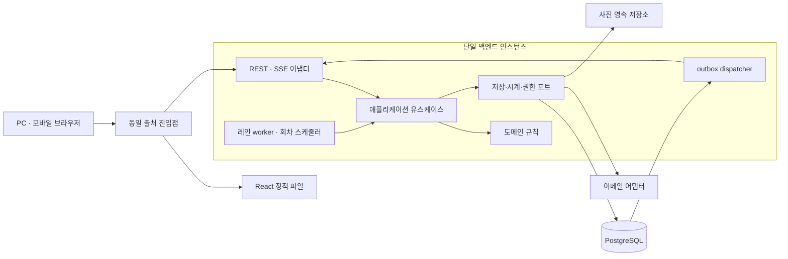

# SYSTEM DESIGN — 4레인 실시간 경매 플랫폼

## 0. 문서 상태와 사용 기준

| 항목 | 내용 |
| --- | --- |
| 작성일 / 버전 | 2026-10-16 / 1.1 |
| 상태 | **USER_APPROVED — 남은 OPEN·미검증 위험을 유지한 구현 기준선, D-095·D-096** |
| D-095 최초 승인 | 검토본 0.2의 시스템 구조·정의된 계약을 구현 기준선으로 채택. 실제 구현·실행·운영 보장은 별도 |
| 범위 | 서비스·모듈·계층, 저장·트랜잭션, 명령·전파·복구, 인증·오류·관측, 실행·배포·병렬 작업 |
| 승인된 입력 | 제품 1.6, DOMAIN-MODEL의 D-091 기준선·D-092~D-094 정책 및 D-095 구조 선택 연결, DECISION-LOG 1.9 |
| 기존 기술 증거 | SPIKE-001 완료 보고서의 지정 사례·환경·실패·미검증 범위 |
| 신규 실행 | 제품 구현·기능·동시성·장애·브라우저·성능·배포 검증 모두 **NOT_RUN** |

**실험 통과는 시스템 설계·공통 계약 초안 작성의 선행조건이 아니다.** 설계는 가정과 미검증 위험을 명시한 채 검토·승인할 수 있다. 승인된 설계, 실행 검증 결과, 운영에서의 보장은 각각 별도로 기록한다. 설계 승인이나 문서 검사 PASS를 서비스 정확성·성능·복구 성공의 증거로 사용하지 않는다.

본문의 모듈·저장 구조·포트·프로토콜은 D-095로 채택한 구현 기준선이다. 남은 OPEN 값·추가 권한과 미완성 기술 메커니즘은 명시된 범위로 유지한다. [공통 계약 0.1.0](../../contracts/README.md)의 정의된 경로·스키마·전파 의미를 같은 승인 범위로 사용한다. 승인 전 검토본은 0.2이며 상태·버전의 정식화로 업무/전파 의미를 바꾸지 않았다.

2026-10-16 D-096으로 업무 도메인과 JPA 엔티티를 통합하고 Spring Data Repository를 서비스에서 직접 사용하는 구조를 채택했다. 별도 영속 모델·매퍼·단순 위임 저장 어댑터를 기본으로 두지 않는다. [ADR-006](../decisions/adr/ADR-006-JPA-DOMAIN-ENTITIES.md)이 선택 이유·경계를, [JPA 적용 계획](../implementation/JPA-ADOPTION-PLAN.md)이 BIGINT PK 전환·수정 범위·검증을 소유한다. 실제 JPA/DDL 전환은 PLANNED / NOT_RUN이며 기존 HTTP·이벤트 계약 0.1.0은 유지한다.

## 1. 근거와 문서별 공식 원본

| 사실 | 원본 |
| --- | --- |
| 요구사항·인수 조건 | [MVP-PRD](../product/MVP-PRD.md) |
| 업무 흐름과 규칙 설명 | [AUCTION-RULES](../product/AUCTION-RULES.md) |
| 승인 이력·현재 OPEN·PROP·HYP·RISK | [DECISION-LOG](../decisions/DECISION-LOG.md) |
| 도메인 불변식·책임·논리적 원자성·TS/TV | [DOMAIN-MODEL](DOMAIN-MODEL.md) |
| 실험 관측과 환경·성능 수치 | [SPIKE-001](../spikes/SPIKE-001.md) |
| 시간·접수·장애 기술 대안 | [ADR-001](../decisions/adr/ADR-001-TRANSITION-TIME.md), [ADR-002](../decisions/adr/ADR-002-DURABLE-RECEIPT-AND-ORDERING.md), [ADR-003](../decisions/adr/ADR-003-FAILURE-AUTHORITY-AND-RECOVERY.md) |
| 초기 구조 선택의 이유·대안·제약 | [ADR-004](../decisions/adr/ADR-004-MVP-STRUCTURE.md) |
| 모듈 경계·의존성·업무별 물리 보호 규약 후보·실행 구조 | 이 문서 |
| HTTP 경로·입출력·오류·이벤트 payload 스키마 | [OpenAPI](../../contracts/openapi.yaml). OPEN 잔여·deferred는 명시된 범위 유지 |
| 이벤트 종류 연결·순서·중복·재생·복구 의미 | [auction-events](../../contracts/auction-events.md). 필드 스키마는 OpenAPI 참조 |

정책·실험 결과를 본문에서 재정의하지 않는다. 관련 내용을 설계에 연결할 때 원본의 R/D/INV/TS/TV 또는 ADR을 참조한다. P0 ADR의 미검증 부분을 이유로 전체 설계를 멈추지 않되, 그 부분을 구현 완료로 취급하지도 않는다.

## 2. 추천 구조와 설계 가정

D-095로 채택한 구조는 **모듈형 모놀리스, 단일 권위 PostgreSQL, REST 명령·조회, SSE 공개 상태 전파**다. 초기에는 앱 인스턴스 하나가 HTTP·레인 worker·전파를 실행한다. 서로 다른 레인의 업무 순서를 전역 입찰 큐로 합치지 않는다. 구성 선택의 대안·채택 이유는 ADR-004가 원본이다.

| 가정 ID | 채택한 구조·기술 가정 | 검토·검증 경계 |
| --- | --- | --- |
| SD-A01 | Java 25·Spring Boot/MVC·Spring Data JPA와 명시 SQL 병용 백엔드, React/TypeScript 프런트엔드 | D-095 조합의 영속화 선택을 D-096·ADR-006으로 변경. 제품 라이브러리의 정확 버전·실행 구성은 구현 시 호환성 확인 후 고정 |
| SD-A02 | Aggregate C안과 동일 DB 자원, 회원×Auction 참여 상태 분리 | 모듈·객체 수명 분리 목적. C가 B보다 빠르다는 가정 없음. 필요한 교차 변경은 같은 업무 트랜잭션 |
| SD-A03 | 공개 확정 시 Auction을 생성하고 공개 가격 기준을 고정 | 공개 직전 선행 요청 반영 후 원자 생성. 출품 시·준비 시 생성 대안과 변경 비용은 ADR-004 참조 |
| SD-A04 | 동일 출처 웹앱, 보안 쿠키와 서버 세션 | 브라우저와 SSE 인증 연계 단순화 목적. 세션 저장·만료·재설정 보안 상세는 §10·OPEN-06. 운영 전용/회원 계정 분리는 D-092의 승인 정책 |
| SD-A05 | 공개 SSE는 상태 전파, 개인 원판정은 인증된 REST 조회와 자동 ACK | 개인 이벤트 채널은 미선택. 공개 전파 성공을 앱의 원판정 확인으로 간주하지 않음 |
| SD-A06 | 사진은 저장 포트로 분리하고 초기 단일 호스트에서는 영속 볼륨 어댑터 사용 | 파일과 DB의 원자성·백업·접근권한 별도 설계. 사진 허용 수·크기·형식은 OPEN-05이며 여기서 정하지 않음 |

위 가정은 D-095의 구현 기준선에 포함된다. C의 교차 조정 비용과 전이 시각·old transaction·자원 경쟁·복구의 실제 보장은 미검증이다. 가정 변경은 Contract Owner의 영향 검토·승인 절차를 따른다.



프로세스를 분리하지 않아도 명령 판정과 SSE 송신은 다른 책임·작업 큐로 실행한다. 브라우저 연결 수와 레인별 직렬 판정 구간, 공용 DB/CPU 경쟁은 별도 확장 제약이다.

## 3. 초기 모듈 경계

아래 표가 초기 모듈 책임의 원본이다. 모듈은 우선 논리적 기능 패키지이며 각각 별도 배포 서비스·Maven 모듈·DB를 만들라는 의미가 아니다.

| 모듈 | 소유할 책임 | 외부에 제공할 경계 | 맡기지 않을 책임 |
| --- | --- | --- | --- |
| `identity` | 회원·이메일 검증·비밀번호·세션·사전 지정 운영 권한 | 검증된 행위자와 역할, 본인 계정 기능, 권한 있는 이메일 조회 | 입찰 순번·회원 전체 입찰 잠금·경매 결과 수정 |
| `listing` | Lot, 소유자·상품 내용·가격 조건·사진 참조·출품 변경 이력 | 상품 규칙과 같은 트랜잭션에 참여할 공개 변경/조회 포트 | 레인 타이머·최고입찰·회차 진행 |
| `auction` | Round·Lane·Auction·Bid·Result, 참여 의도·접수/원판정·운영 명령, 진행·복구 조정 | 출품 귀속/배정/취소와 경매 유스케이스, 공개 상태·개인 판정 조회 포트 | HTTP·실제 메일 송신·사진 바이너리 처리 |
| `query` | 공개/본인/당사자/운영자 DTO, 목록·상태·결과·연락처 조회 정책 | 권한별 조회·일관된 snapshot | 도메인 상태 변경·권위 판정·원판정 대체 |
| `realtime` | 공개 outbox 재생·연결·커서·heartbeat·느린 연결 격리 | SSE 전송과 재동기화 신호 | 입찰 승인·앱 원판정 ACK·개인정보 일괄 직렬화 |
| `bootstrap` | HTTP 진입점·보안 어댑터·설정·의존성 조립·실행 시작/종료 | 앱 실행물과 어댑터 | 업무 규칙·직접 최고가/결과 저장 |

`auction` 내부는 `round`, `lane`, `bidding`, `participation`, `recovery` 책임으로 나누되 먼저 독립 배포나 별도 데이터 자원으로 분리하지 않는다. Bid와 Result의 변경 권한은 Auction에 남긴다. Lane은 현재 대상·원인별 중단·발생 건을, Auction은 입찰 단계·최고입찰·마감·결과를 소유한다. 장애 증거는 recovery 기록이 보존하고 실제 Lane 보류 적용은 같은 보호 규약을 따른다.

출품·취소·공개처럼 회차와 Lot를 함께 다루는 유스케이스는 `auction.application`이 조정하고 `listing` 공개 포트를 호출한다. 바깥 업무 트랜잭션에 참여하며 모듈 호출 중 독립 commit을 만들지 않는다. `listing`이 `auction`으로 callback하는 순환 의존성을 만들지 않는다.

## 4. 계층과 의존성 규칙

| 계층 | 책임·허용 의존성 |
| --- | --- |
| 도메인 | JPA 엔티티와 업무 모델을 통합하고 Jakarta Persistence 매핑 허용. 불변식·금액·대상·상태 전이·결과 계산. 검증된 행위자·원접수 맥락·권위 시각 증거를 입력으로 받음 |
| 애플리케이션 | 소유 기능의 Spring Data Repository 인터페이스와 이를 직접 사용하는 서비스. 유스케이스 순서, 중복 확인, 트랜잭션·진행 권한·대상 확보, 도메인 호출, 저장·outbox 조정 |
| 공개 API/포트 | 식별자·불변 입출력·의미 있는 업무 연산. 다른 기능의 내부 엔티티/저장소를 노출하지 않음 |
| 인프라 어댑터 | custom repository fragment·명시 SQL·파일·메일·시계·worker·HTTP/SSE. 의미 있는 기술 협력 구현. 기본 CRUD를 감싸는 매퍼·저장 어댑터는 만들지 않음 |

1. HTTP 어댑터는 애플리케이션 유스케이스를 호출한다. 도메인은 JPA 매핑을 허용하되 Spring 서비스·Repository·JDBC·HTTP·SSE·현재 시각 직접 읽기에 의존하지 않는다. 엔티티는 업무 메서드로 변경하고 서비스가 트랜잭션·Repository 호출을 조정한다.
2. 모듈 사이 쓰기 의존성은 `auction → listing.public`으로 제한한다. 행위자 정보는 보안 경계에서 검증해 전달하고 경매에 계정 객체 전체를 로딩하지 않는다.
3. `query`는 공개 조회 포트 또는 명시적으로 소유한 읽기 전용 SQL projection을 사용한다. 교차 테이블 조회는 허용된 읽기 예외이며 다른 모듈의 저장소를 호출해 상태를 수정하지 않는다.
4. `realtime`은 자신의 outbox 읽기 포트·공개 DTO 매핑을 사용한다. 도메인 객체를 그대로 직렬화하거나 업무 저장소를 수정하지 않는다. 발행 관리 메타데이터는 자체 전파 책임에 한정한다.
5. 각 기능 내부의 인프라가 포트를 구현하고 `bootstrap`이 조립한다. 중앙의 공통 서비스가 모든 도메인 규칙을 소유하게 만들지 않는다.
6. 공유 코드는 식별자·불변 금액/시간 맥락 등 작은 값으로 제한한다. 공통 모듈에 Repository·인증 서비스·가변 경매 상태를 모으지 않는다.
7. Auction의 최고가·낙찰자·마감은 공개 setter로 따로 갱신하지 않는다. 승인된 하나의 행위를 통해 일관되게 변경한다.

현재 패키지 검사와 JDBC 공개 조회는 구현돼 있다. JPA 의존성·엔티티·Repository 경계의 실제 검증은 전환 카드에서 추가한다. 기존 검사 PASS를 JPA 영속화·업무 불변식의 통과로 확대하지 않는다.

## 5. 저장 구조와 데이터 소유권

단일 권위 DB를 사용하되 다음 논리 기록을 구별한다. 표의 이름은 실제 DDL·테이블/클래스 명칭 확정이 아니다.

| 기록 범주 | 소유·보호할 사실 |
| --- | --- |
| 회원·검증·세션 | identity만 변경. 인증·비밀번호 재설정·세션 수명은 계정 계약으로 관리 |
| 출품·사진 참조 | listing의 원내용·가격·소유자·공개 내용 버전·취소 이력 |
| 회차·운영 레인 | 모집/공개/예약/실제 시작, 레인 수·배정, 실제 시작 때 고정한 시간, 단일 진행 점유 |
| Auction·승인 Bid·Result | 공개 기준 가격, 원대상, 단계·구간·최고입찰·유일한 결과와 근거 |
| 회원×Auction 참여 상태 | 현재 공유 의도, 원키·경매·금액, 최종 판정 확인과 신규 제한 |
| 공식 접수·원최종 판정·운영 명령 | 불변 원내용·원시각·범위별 순번·원판정, 명령 종류·원대상·발생 건·원 R |
| 권위 전이·장애·진행 권한 | transitionId·시각 증거·authority 세대·원인별 발생 건·이력 확인·운영자 확인 |
| 공개 outbox·전파 메타데이터 | 같은 업무 변화의 공개 payload·레인/회차 버전, 전송 관리 상태. 클라이언트 확인 사실과 구별 |

업무 테이블의 내부 PK/FK는 BIGINT 방향으로 설계하고 외부 opaque ID와 구별한다. 업무 유일성 제약·금액·공개 revision·공식 순번은 PK로 대체하지 않는다. 상세 전환은 ADR-006과 JPA 적용 계획을 따른다.

DB에는 양의 KRW 정수·최저낙찰가 관계, 같은 회원+원키의 유일성, 현재 공유 의도 하나, 대상·순번·버전 유일성, 결과 단일성 등을 지원하는 제약을 둔다. 정확한 제약·색인·금액 자료형은 DDL 설계에서 검토하며 숫자 자료형 한계를 미승인 제품 금액 상한으로 적용하지 않는다.

원판정·중복 식별의 MVP 자동 만료 없음은 D-080을 따른다. outbox 재생 창·사진 정리·세션 만료는 서로 다른 수명이다. 재생 창이 닫혀도 원입찰 기록을 삭제하거나 새 요청으로 재실행하지 않는다. 실제 운영 보존·삭제는 OPEN-12가 원본이다.

원입찰·운영 명령은 단순 앱 재시작·회차 이동·stream 세대 변경에도 같은 키와 원내용으로 조회한다. DB 백업 복원으로 원기록이 소실됐다면 세대 변경만으로 중복 문제가 해결됐다고 판단하지 않는다. 권위 이력 확인과 보류는 ADR-003을 따른다.

사진 바이너리와 DB 참조는 하나의 DB 트랜잭션으로 원자 저장되지 않는다. 임시 업로드 → 소유자·존재 확인 → 출품 연결의 흐름과 고아 파일 정리·실패 재시도를 설계한다. 사진이 필요한 출품을 실제 파일 확인 없이 성공 처리하지 않는다. 비공개 파일은 추측 가능한 정적 경로로 공개하지 않고 공개 상태·권한을 확인한 경로로 제공한다.

## 6. 경쟁 범위와 업무 트랜잭션

### 6.1 범위별 직렬화

| 범위 | 보호할 경쟁 | 매 입찰에 요구하지 않을 잠금 |
| --- | --- | --- |
| 일정·진행 점유 | 모집 기간 중복, 시작 후보 예약순, 최대 한 진행 회차 | 전체 일정·진행 점유 행 갱신 |
| Round | 출품 공식 순서·배정·공개 고정, 시간 설정·실제 시작/취소, 전체 완료 | 정상 입찰마다 Round 배타 변경 |
| 회차×Lane | 입찰·상품 취소·중단/재개의 공통 순번, 현재 대상·자동 경계 | 다른 레인 전역 접수 순번 |
| Auction | 승인 Bid·단계·마감·결과의 일관성 | 과거 입찰 전체 로딩 |
| 회원×Auction | 공유 등록·인계·원판정 ACK·새 의도 경합 | 회원의 모든 레인·상품에 대한 잠금 |
| 회원/운영자×원키 | 같은 내용 합류·내용 충돌·원접수/원결과 보존 | 세대 변경에 따른 키 재사용 |

기본 명령 경로는 짧은 `READ COMMITTED` 트랜잭션과 명시적 행 gate·고유 제약을 사용하는 후보다. 여러 행의 모집 중복 같은 제약은 별도 일정 보호 규약 없이 격리 수준 이름만으로 해결됐다고 판단하지 않는다. 공개 snapshot은 gate 없는 읽기 전용 `REPEATABLE READ` 후보로 같은 읽기의 상태·watermark를 확보한다. 실제 SQL·교착·재시도는 구현 때 검증한다.

### 6.2 물리 보호 규약 후보

권한 guard → 필요한 일정/진행 점유 → 필요한 Round → 레인 번호순 Lane → 참여/원키 등 관련 기록의 순서를 우선 비교한다. 모든 경로가 모든 잠금을 잡는 것은 아니다. 공유 의도 등록·ACK·다른 레인의 같은 원키 충돌까지 포함한 최종 잠금 그래프는 RC-11 검증 대상이다.

정상 입찰은 Lane gate에서 처리하되, 마지막 레인 종료처럼 상위 범위가 필요한 경로는 처음부터 그 범위를 확보하고 조건을 재검증한다. Lane을 잡은 뒤 상위 잠금이 필요하다고 알게 되면 그 상태로 역순 upgrade하지 않고 해당 미커밋 판정을 롤백한 뒤 정해진 순서로 재진입하는 후보를 둔다. **이미 내구 접수된 원시각·순번은 보존하며 재진입을 새 접수로 만들지 않는다.** 정상 입찰 전체를 Round 잠금으로 직렬화해 이 문제를 숨기지 않는다.

행 잠금은 경쟁 행 접근을 조정하며 HTTP 선착순이나 장애 감지를 제공하지 않는다. [PostgreSQL 명시적 잠금](https://www.postgresql.org/docs/18/explicit-locking.html)

### 6.3 함께 확정해야 할 변화

| 업무 | 같은 트랜잭션·보호 규약으로 묶을 변화 |
| --- | --- |
| 회차 생성·일정 변경 | 일정 관계·현재 시각·모집 기간 중복 없음·변경 자격·공개 시점 재계산 |
| 출품·공개 전 레인 수 변경 | 모집 귀속·최초 공식 순번·유효 Lot 등록·배정 또는 남은 유효 출품 재배정 |
| 공유 의도 등록·인계 | 회원×Auction의 하나의 미확인 의도·회원+키의 원경매/금액 결합·등록 확인 후 같은 의도로 제출 가능성 |
| 공식 접수 | 원내용·공유 의도 연결·원시각·범위별 증가 순번·미결 기록. 상세는 ADR-002 |
| 입찰 판정 | Lane의 현재 Auction·중단 조건, Bid·최고입찰·단계·마감·원판정·필요 공개 버전·outbox |
| 중단·재개 | 원명령 결과·현재 발생 건·원인별 해제 조건·단계·시간 경계·공개 상태. 상세는 ADR-001/003 |
| 상품 취소 | 원 Lot/Auction의 자격·취소·진행 대상 제외·이력과 운영자 취소 사유, Lane 중단 유지 또는 다음 전환 |
| 정상 종료·다음 전환 | 선행 접수 처리·현재 마감·유일한 결과, 현재 대상 해제와 다음 준비 또는 Lane 종료 |
| 공개·배정 | 공개 직전 유효 요청 반영, Lot 최종 내용·레인 배치·공개 번호 고정과 Auction 생성 |
| 공개 후 시작 전 회차 취소 | 자기 공통 순서의 공개·미시작 자격, 취소 이력·상품 경매 미진행 표시·이후 시작 차단. 기존 개별 취소 보존 |
| 회차 실제 시작 | 예약순 자격·회차 시작/취소 순서, 단일 진행 점유·시간 고정·공통 시작 사실·레인 초기 상태 |
| 마지막 레인 종료·회차 완료 | 모든 운영 레인 종료·보류 없음 확인, 회차 완료와 점유 해제. 다음 회차는 시작 자격 재검증 |
| 공유 의도 ACK | 원최종 판정의 확인과 그 의도에 한정한 제한 해제. 새 의도에 옛 ACK 효과 적용 금지 |

도메인 Aggregate 분리는 이 변화들을 별도 DB나 독립 commit으로 분리하는 근거가 아니다. 파일·메일·SSE 호출은 위 업무 트랜잭션에서 기다리지 않는다.

## 7. 주요 처리 흐름

### 7.1 입찰

1. 인증·기본 입력 검증 후 회원×Auction 공유 의도를 등록하거나 같은 의도를 조회한다. 등록 확인은 공식 입찰 접수·순번 예약이 아니다.
2. 등록 확인한 키·원경매·원금액으로 실제 입찰을 제출한다. 접수 트랜잭션은 ADR-002에 따라 원기록을 내구 저장하고 처리 중 사실을 응답한다.
3. 레인 worker는 가장 낮은 실제 미결 순번을 선택한다. 선행 입찰·제어·현재 개시/마감을 반영한 상태에서 도메인이 승인/거절을 판정한다.
4. 판정과 필요한 상태·outbox를 함께 커밋한다. 응답 유실·전파 실패는 승인 취소가 아니며 원키 조회로 복구한다.
5. 앱은 원최종 판정을 수신·반영한 뒤 원키·원판정 식별에 결합한 자동 ACK를 보낸다. 어느 기기든 이 확인이 끝나면 해당 공유 제한을 해제한다.

거절·시간초과·등록 확인 중·처리 확인 중·현재 최고입찰 여부·낙찰 결과를 하나의 성공/실패 boolean으로 합치지 않는다. 원거절 재전송은 당시 원거절을 유지한다. 최신 화면의 가격으로 원제출 금액을 자동 인상하지 않는다.

### 7.2 모집·공개·예약 시작

현재 진행 회차와 미래 모집 회차는 병행한다. 모집 구간 귀속과 공식 출품 순번을 확인하고, 최소 대기 수·레인 번호 동률·최초 등록순으로 배정한다. 일반 수정·취소는 나머지 배치를 옮기지 않으며 공개 전 레인 수 변경만 전체 재배정한다.

공개 시각 전에 접수한 유효 변경을 반영한 뒤 공개 내용을 고정한다. 공개 시점의 Lot 기준에서 Auction을 생성하는 후보이며 복사한 가격 사본을 이후 독립 변경하지 않는다. 공개 후 취소는 공개 번호·자리를 유지하고 진행에서 건너뛴다. 공개 정각 취소의 자격과 시간 설정 고정 시점은 각각 기존 정책을 따르며 공개와 실제 시작을 혼동하지 않는다.

스케줄러는 예약 시각순 후보와 선행 회차 완료를 확인하고 Round의 공통 시작/취소 순서에서 자격을 다시 검증한다. 빈 회차도 자격을 충족해 실제 시작한 뒤 즉시 완료한다. 첫 상품 있는 레인들은 하나의 실제 시작 사실 S를 공유하며 이후 전환은 레인별 N을 사용한다. 회차 취소의 허용 범위·상품 미진행 표시는 D-084~D-086을 따른다.

### 7.3 타이머·중단·복구

타이머는 현재 Auction·단계·유효 개시/마감과 관련 버전을 재검증한다. 오래된 callback으로 시간을 다시 주거나 종료하지 않는다. 선행 미결 요청을 마감이 추월하지 않으며 개시·현재 마감 정각의 우선순위는 D-064/065를 따른다.

시간 입력을 확보하는 애플리케이션 포트와 도메인 시간 계산을 분리한다. 권위 전이 확정의 실제 구현·projection 지연·커밋 증거는 ADR-001의 미검증 위험으로 남긴다. 초안에서는 의미와 책임을 정의할 수 있으며 `pg_xact_commit_timestamp` 하나로 전체 시간 보장이 끝났다고 가정하지 않는다.

초기 단일 진행 주체와 중복 시작 차단은 ADR-003을 따른다. 장애 범위·마감 선후·원기록을 확인하고 원인별 보류를 보존한다. DB 복귀·앱 시작·복구 확인·운영자 재개를 구분하며 수동 중단을 장애 확인만으로 해제하지 않는다. 이미 실행 중인 old transaction의 확정 권한은 핵심 검증 위험이다. 복구 불능의 강제 유찰·취소를 추가하지 않는다.

## 8. 실시간 전파와 클라이언트 복구

### 8.1 전파 책임

판정 트랜잭션은 공개 변화와 outbox를 함께 저장한다. dispatcher가 커밋 후 outbox를 읽어 자신의 SSE 연결에 보낸다. 발행 표시나 연결 큐 삽입 성공은 클라이언트 수신·앱 반영 ACK가 아니다. 재전송·중복 가능성을 전제하고 클라이언트가 중복을 제거한다.

레인별 상태 변화는 full public state를 보내는 후보를 우선한다. 프런트엔드가 가격·단계·마감의 서로 다른 변경 조각을 잘못 조합할 부담을 줄이기 위해서다. 모든 입찰 이력을 공개하거나 모든 중간 상태가 개별 화면에 반드시 보인다는 의미는 아니다. 자동 상품 전환 후 종료 결과의 표시 방식·시간은 OPEN-08이다.

### 8.2 순서와 커서

| 식별 | 의미 |
| --- | --- |
| `schemaVersion` | payload 의미·구조 버전 |
| `streamEpoch` | 회차/복원 세대가 달라져 같은 상태 버전을 비교할 수 없는 경우의 식별 |
| `roundId + laneId + laneVersion` | 같은 세대의 레인 상태 순서 |
| `roundVersion` | 레인과 별도로 공개 회차 일정·상태 변화를 식별할 후보 |
| `receiptSequence` | 공식 요청 판정 순서. 공개 상태 버전과 다른 개념 |

회차의 1~4레인을 단일 공개 SSE로 구독하는 후보를 둔다. 커서는 관련 회차·레인 watermark를 담은 불투명 값으로 표현하며 전역 outbox 증가 ID를 그대로 재생 순서로 사용하지 않는다. 전역 ID 할당과 레인별 커밋이 역전된 반례는 SPIKE-001을 참조한다. authorityEpoch·incidentId·중단 발생 건을 streamEpoch와 합치지 않는다.

### 8.3 재접속 절차

채택한 공통 계약은 **snapshot-first → cursor 이후 영속 재생 → live 인계**로 정의한다. 브라우저가 일관된 snapshot을 먼저 받은 뒤 그 cursor로 연결하며, 서버는 재생 중 live 버퍼를 먼저 등록해 구독 등록 전후 변화를 연결해야 한다. 상세 순서·scope별 비교·cursor 우선순위·중복 제거·재동기화의 원본은 [이벤트 계약](../../contracts/auction-events.md)이다. 초기 설계의 선구독 후보를 동시에 별도 규약으로 유지하지 않는다. 실제 무손실 인계의 달성은 구현에서 검증한다.

snapshot과 공개 SSE는 개인 원판정/앱 확인을 대체하지 않는다. 로그인 사용자의 공유 의도·원요청·ACK는 [OpenAPI](../../contracts/openapi.yaml)의 개인 조회 경로로 복구한다. 실제 재생/live 인계·동시성·네트워크 복구는 아직 검증하지 않았다.

중단·보류 snapshot은 그대로 복원하며 자동 재개하지 않는다. 느린 연결은 유한 큐로 격리하고 초과 시 연결을 닫아 재동기화한다. 연결 처리로 입찰 트랜잭션을 기다리게 하지 않는다.

SSE 표준의 `Last-Event-ID`는 재접속에 쓸 값을 전송할 뿐 업무 replay 보존·레인 순서·앱 반영 확인을 대신하지 않는다. [WHATWG SSE](https://html.spec.whatwg.org/multipage/server-sent-events.html)

## 9. HTTP·이벤트 계약과 연결할 경계

| 계약 묶음 | 시스템 설계에서 정한 책임 | 공통 계약이 소유하는 상세 |
| --- | --- | --- |
| 계정·사진·출품·회차 설정 | 인증과 입력 검증, 업로드/메일과 DB의 실패 경계 | 경로·메서드·필수 필드·허용값·보안 조건 |
| 공유 의도·실제 입찰 | 등록 확인과 공식 접수 구분, 원키·원내용 유지 | 각 요청/응답·중복/충돌·접수/처리 상태·조회 경로 |
| 원판정·ACK | 불변 승인/거절과 원판정 확인·회원×Auction 제한 해제 | 원판정 식별과 ACK 멱등성·인증 요구 |
| 운영 명령·복구 | 원명령·원대상·현재 발생 건·원 R·증거 확인 | 요청번호·결과 조회·복구 확인·재개·충돌 코드 |
| 공개·개인 조회 | DTO와 권한 분리, 같은 읽기의 snapshot | 목록/상세/결과·snapshot·본인 기록·연락처 필드 |
| 공개 이벤트 | outbox·버전·중복 제거·재동기화 | 종류·envelope·payload·schemaVersion·커서·heartbeat |

입찰 접수·판정·ACK와 오류의 정확한 HTTP 매핑은 OpenAPI에서 한 번 정의한다. 접수와 업무 승인을 같은 의미로 표현하지 않는다. 입찰 최종 결과는 원승인/원거절이며 처리 중·조회 없음·시간초과는 제3의 최종 결과가 아니다.

금액·카운터·식별자·시각의 wire 프로파일은 OpenAPI가 원본이다. 이 기술 표현을 미정 금액 상한이나 실제 시계 정확도 승인으로 혼동하지 않는다. 일정 계산·표시는 Asia/Seoul이며 실제 시각 취득·정밀도·연속성 위험은 ADR-001과 연결한다.

## 10. 인증·권한·정보 노출

### 10.1 보안 구조 후보

동일 출처에서 Spring Security와 서버 세션을 사용하고 세션 쿠키는 HttpOnly·Secure·적절한 SameSite 속성을 둔다. 변경 요청에는 CSRF 방어를 적용한다. 세션 저장은 PostgreSQL 어댑터를 우선 비교하되 조회/경매와의 자원 경쟁·만료·재접속을 확인한다. 구체 설정은 보안·계약 단계에서 승인한다. [Spring Security CSRF](https://docs.spring.io/spring-security/reference/6.5/servlet/exploits/csrf.html)

회원/운영자 ID는 인증 맥락에서 확보하며 요청 본문의 임의 ID로 행위자를 바꾸지 않는다. 다른 기기의 동일 의도 인계는 로그인한 같은 회원임을 확인한다. 다중 기기 공유 정책을 단일 로그인 강제나 한 기기만 입찰 허용으로 바꾸지 않는다. 세션 만료 후에는 재인증하고 원키로 복구하며 만료가 원판정·미확인 의도 삭제 사유가 되지 않는다.

이메일 검증·비밀번호 재설정은 토큰의 소유 확인·일회 사용·기한·시도 제한을 설계할 필요가 있으나 구체 조건·수치는 OPEN-06에 남긴다. 이메일 검증을 실명 확인으로 표시하지 않는다. 재설정 후 기존 세션 처리·계정 수명은 아직 미정이다. D-092에 따라 운영자 계정은 운영 전용이고 회원 기능은 별도 일반회원 계정을 사용한다. 운영자 준비는 비밀을 담지 않은 사전 프로비저닝 절차로 제안하며 일반 가입으로 운영자 권한을 부여하지 않는다.

### 10.2 권한별 DTO

| 조회/행위 | 권한 경계 |
| --- | --- |
| 공개 목록·상세·실시간·종료 결과 | 비회원 허용. 공개 전 상품·비공개 최저낙찰가·낙찰자 식별·거래 이메일 제외 |
| 본인 출품·참여·원요청·ACK | 인증된 해당 회원 범위. 원키를 알더라도 타인 기록 조회 불가 |
| 출품 생성·변경·취소 | 가입 완료·소유자와 해당 시점 자격 검증. 공개/개시 경합은 공통 순서 적용 |
| 입찰 | 가입 완료 회원, 본인 출품/현재 최고자 등 업무 자격은 판정 차례에 검증 |
| 낙찰자 식별 | 해당 출품자·낙찰자·운영자만. 구체 필드는 OPEN-07 |
| 거래 연락 이메일 | 낙찰된 거래의 당사자 서로만. 운영자에게 자동 부여하지 않음 |
| 회차 설정·레인 제어·운영자 취소·복구 확인 | 사전 지정 운영자. 권한이 모든 개인정보 조회를 뜻하지 않음 |

최저낙찰가 원금액은 공개 결과에도 넣지 않는다. D-094에 따라 유찰 종료 응답·결과 화면에는 최고입찰가를 제공하지 않으며 공개 snapshot·이벤트에도 같은 결과 스키마를 쓴다. 진행 중 이미 관측한 가격을 회수하거나 본인 원입찰 기록을 지우는 정책은 아니다. 운영자의 원금액·이메일·개인 목록 관리 조회와 개별 입찰 이력 범위는 OPEN-07이다. 식별자 숨김만으로 접근통제를 대체하지 않고 매 요청에서 권한을 검사한다. 공개 SSE와 로그에도 같은 정보 경계를 적용한다.

## 11. 오류·불명 상태·재시도

| 분류 | 서버·클라이언트 책임 |
| --- | --- |
| 접수 전 입력/인증/권한 오류 | 오류 응답과 필요한 안내. 원입찰 최종 거절·공유 제한 해제로 바꾸지 않음 |
| 원내용 충돌·다른 미확인 의도 | 원기록 보존. 충돌과 원요청의 최종 판정을 구분 |
| 내구 접수 후 미판정 | 처리 중으로 조회/재전송 연결. 새 키 자동 생성 금지 |
| 기록된 최종 업무 거절 | 원거절 코드·원요청 근거 반환. 상태가 바뀌어도 같은 키 재심사 금지 |
| commit 결과 불명·HTTP timeout·조회 기록 없음 | 같은 키로 권위 조회/재전송. 원판정·미접수·실패를 추정하지 않음 |
| 권위 이력·영향 선후 불명 | ADR-003의 증거·범위에 따라 보류. 개인 응답 유실과 구별 |
| SSE·공개 조회 실패 | 연결·snapshot 복구. 이것만으로 원입찰을 거절하거나 전체 장애로 분류하지 않음 |

오류 응답은 추적 식별·기계 판독 코드·사용자 안내·필드 오류를 분리하는 후보로 둔다. 내부 SQL·stack·비밀값은 응답에 노출하지 않는다. 공통 envelope와 HTTP 코드별 접수 여부 의미는 OpenAPI에서 정의한다. 특히 timeout·5xx만으로 접수 실패를 보장하지 않는다.

재시도는 같은 내용·같은 키를 유지하며 간격·상한은 OPEN-10의 상세로 남긴다. 일시적으로 자동 재시도를 멈춰도 미확인 상태가 종료되는 것은 아니다. 신규 입찰 제한은 해당 회원×Auction에만 적용한다.

## 12. 로그·지표·추적과 자원 보호

| 관측 구간 | 필요한 관측 |
| --- | --- |
| HTTP→접수 | 검증·pool 대기·gate 대기·원시각·접수 성공/불명 |
| 접수→판정 | 레인별 미결 수·최장 나이·판정 지연·승인/업무 거절·중복/충돌 |
| DB/트랜잭션 | 활성 연결·획득 대기·timeout·락/교착·rollback·commit 결과 불명 |
| 상태→전파 | outbox 적체/최장 나이·dispatcher 지연·큐 초과·송신 실패 원인 |
| 클라이언트 복구 | stream 오류·gap/세대 불일치·snapshot 요청 합치기·복원 완료·원판정/ACK 복구 |
| 진행·장애 | owner/authority 세대·incident 관측·중단 발생·확인·재개·unknown 구간과 시계 전제 |

correlationId와 원요청/명령·transition·회차·레인·버전·incident 식별을 연결한다. 비밀번호·인증/재설정 토큰·세션값·거래 이메일·개인 payload 전체를 기록하지 않는다. 민감 정보 없이 판정 이력을 추적할 수 있도록 설계한다.

SPIKE의 200연결 실패를 반영해 클라이언트 재동기화를 한 번으로 합치고 재시도를 분산한다. 서버는 같은 snapshot 조회 합치기와 조회/전파·상태 변경의 자원 예산을 비교한다. 조회 합치기는 공개 데이터 또는 동일한 인증 주체·권한 범위 안에서만 적용하며 개인 원판정·연락처 응답을 다른 사용자와 공유하지 않는다. 중요 변경 작업을 조회 폭주가 고갈시키지 않도록 동시성 경계를 두되 pool 분리 여부·개수·상한은 계측으로 조정할 운영 후보다. 숫자 증설만으로 해결됐다고 판단하지 않는다.

기존 100연결 지정 부하 통과는 같은 PC·loopback·fixture의 증거다. 정확한 수치·측정 경계·200연결 실패는 SPIKE-001이 원본이며 운영 수용량·외부망·자동 재연결·전체 제품 인수 완료로 확대하지 않는다. 목표 p95와 새 검증의 PASS/NOT_RUN은 구분한다.

## 13. 로컬 실행·테스트·초기 배포

### 13.1 제안 저장소 구조

```text
backend/                 # 향후 제품 코드. 현재 생성하지 않음
  identity/ listing/ auction/ query/ realtime/ bootstrap/
frontend/                # 향후 React/TypeScript 코드
contracts/               # HTTP·이벤트 기준선, OPEN 잔여·공유 예제와 정적 검사
infra/                   # 향후 로컬 구성·배포·마이그레이션 실행 안내
docs/                    # 승인 기준·설계·ADR·검증 근거
experiments/spike-001/    # 기존 격리 실험과 원자료. 제품 코드로 자동 편입하지 않음
```

이 트리는 논리적 책임을 보여주는 제안이며 빌드 도구·폴더·실행 스크립트가 이미 존재한다는 뜻이 아니다.

### 13.2 로컬 실행 후보

PostgreSQL·개발용 메일 수신기·사진 영속 볼륨을 로컬 구성으로 재현하고, 앱과 프런트엔드는 개발 실행 또는 컨테이너로 연결한다. 버전 있는 DB 마이그레이션과 비밀 없는 환경 예제를 제공한다. 운영자 계정·비밀번호를 코드·예제·로그에 하드코딩하지 않는다.

fixture는 실제 계정·이메일과 분리한 시험 데이터로 만든다. 합성 시각·장애 주입·강제 초기화 기능은 격리 시험에서만 활성화하고 운영 HTTP에 노출하지 않는다. 기존 실험의 reset·관리 API를 제품 운영 API로 복사하지 않는다.

### 13.3 검증 배치

| 시점 | 검증할 대상 |
| --- | --- |
| 설계·계약 초안 | 문서 연결·스키마/예제·오류/권한·모의 상태 흐름의 정합성. 서비스 실행 보장 아님 |
| 구현 중 | 순수 규칙·경계, 실제 PostgreSQL 트랜잭션/고유성·동시성·중복·접수/타이머 경합 |
| 해당 메커니즘 구현 시 | ADR의 TM/RC/FA 중 영향 경로, 전이 시각·old tx·복원·세대·자원 보호 |
| 통합·인수 | 실제 브라우저·다중 기기·계정·출품/경매/결과·연락처, 오류/장애/재접속 |
| 보장·운영 적용 판단 | 합의한 성능·실패 표본·외부망/배포·DB 복원과 운영 전 OPEN 해결 |

추가 독립 spike를 반드시 먼저 실행할 필요는 없다. 필요한 검증을 구현 중 통합시험으로 수행할 수도 있다. 다만 검증하지 않은 정확성·시간·장애·성능 보장을 달성했다고 보고하지 않는다. 35개 TM/RC/FA는 검증 후보 목록이며 모두를 설계 진입 조건으로 사용하지 않는다.

### 13.4 초기 배포와 종료·복구

동일 출처 진입점은 정적 프런트엔드와 REST/SSE를 연결하고 TLS·SSE buffering/timeout·연결 종료를 구성한다. 초기 앱 한 인스턴스·권위 DB·사진 영속 저장소와 백업을 기준으로 한다. 다중 active·자동 DB failover·무중단 배포는 별도 채택 대상이다.

앱 시작은 마이그레이션·단독 진행 권한·이력 확인을 거쳐 readiness를 결정한다. 종료는 새 접수 중지→진행 중 트랜잭션 결말 확인→미결·진행 연속성 기록→연결 종료로 설계하며 예기치 않은 재시작은 ADR-003의 복구 확인을 거친다. 배포로 접수 연속성이 끊겼다면 clean 종료 표시만으로 자동 재개하지 않는다.

DB와 사진 백업·복원 및 비밀 설정을 운영 절차에 포함한다. 백업 복원 후 원판정·키 이력 소실 여부와 stream 세대를 확인하고 오래된 앱·cursor가 쓰기를 계속하지 않게 한다. 복원 검증을 하지 않은 백업 생성만으로 복구 가능을 보장하지 않는다.

## 14. 백엔드·프런트엔드·QA 병렬화

| 작업자 | 승인된 범위에서 독립 진행 가능한 작업 | 공동으로 유지할 접점·잔여 결정 |
| --- | --- | --- |
| 백엔드 | 모듈 공개 포트·도메인 규칙·저장/트랜잭션 후보, 각 위험 경로 구현과 검증 계획 | 상태·식별·원판정 의미, 실제 경로·필드·인증·오류 |
| 프런트엔드 | 모의 서버로 등록/접수/판정/ACK 구분, 4레인 상태·중복 제거·복구·개인 상태 UX | 계약 0.1.0과 예제, 시간 표현·stream 커서·권한별 DTO |
| QA | 승인 AC/INV/TS에서 독립 기대값·권한표·실패/재접속 시나리오 도출 | 미결정 필드/수치 표시, 검증 환경과 성공·실패 측정 경계 |

추가 실험이나 상대 구현 완료를 기다리지 않고 승인된 범위의 작업을 병렬로 시작할 수 있다. 공통 모의 연동에는 같은 계약 0.1.0·공유 예제·담당 원본·OPEN 경계가 필요하다. 미정 입력·권한·보안 값은 담당자가 임의 채우지 않고 해당 경로 구현 전에 별도 결정한다. 실제 제품 코드 작성은 후속 구현 작업에서 진행한다.

D-095의 공통 기준선은 정의된 OpenAPI·이벤트 의미·정적 검증 예제·역할별 권한과 오류 처리다. 정확한 파일 hash와 승인 범위는 [승인 기준선](../../contracts/approved-baseline-0.1.0-architecture-1.1.json)으로 식별한다. OPEN·deferred와 실제 실행 검증은 별도로 남긴다.

변경은 구현 에이전트가 직접 의미를 바꾸는 대신 변경 이유·관련 R/D/INV·계약 diff·호환성·소비자/QA 영향을 Contract Owner에게 제출하고 사용자 승인을 받는다. 원본 문서만 변경한 뒤 참조를 맞추며 같은 스키마를 여러 문서에서 따로 관리하지 않는다. 상세 변경 절차는 [ADR 검토 목록](../decisions/adr/README.md)을 따른다.

## 15. 남은 결정과 위험의 처리 시점

| 항목 | 다음 처리 | 구현 기준선에 미치는 영향 |
| --- | --- | --- |
| SD-A01~06 구조·기술 가정 | D-095 채택. 실제 구현과 검증으로 상세화하며 변경 시 ADR 절차 적용 | 초기 구현 기준선. 정확 라이브러리 버전·DDL·클래스 및 실제 보장은 후속 |
| 실제 전이 확정·정밀도·시계 연속성 | ADR-001, OPEN-10. 구현 경계에서 TM 검증 | 시간 포트·의미는 설계하고 실제 보장은 미검증으로 유지 |
| 진행 중 tx·장애 감지/증거·복구 권한 | ADR-003, OPEN-09/10. 구현·복구 검증 | 초기 단일 주체 가정·명시적 복구와 잔여 위험 표시 |
| 순번/원키·공유 의도·범위 간 잠금 | ADR-002 및 §6. SQL·프로토콜 단계에서 RC 검증 | 접수/판정/ACK와 상위 범위 재진입 책임을 정의 |
| 입력·계정·조회·UX 상세 | DECISION-LOG의 OPEN-01/02/05/06/07/08 잔여 | 해당 경로/필드/검증값의 계약 최종화 전에 결정. 미승인 수치·권한을 넣지 않음 |
| 이벤트 종류·커서·재생 창·느린 연결 설정 | [공통 계약](../../contracts/README.md)의 정의된 의미 채택. cursor 실제 encoding과 운영 수치는 후속 결정 | wire 스키마·복구 의미는 구현 기준선. 실제 인계 검증 NOT_RUN |
| 환경·성능 표본·자동 재접속 | OPEN-13와 브라우저 범위 합의 후 인수 검증 | 목표와 기존 실험 근거 구분. 새 성능 보장 없음 |
| 개인정보·연락처 수명·실거래 운영 | OPEN-12/14, 실제 운영 전 검토 | 사진·개인정보 영구 보존이나 포괄 운영자 접근을 승인하지 않음 |

OPEN-03/04/11 등 해결된 정책을 다시 미정으로 돌리지 않는다. 본문에서 새 기술 제안을 했다는 사실은 기존 OPEN 해결 승인이나 제품 범위 확대가 아니다.

## 16. 문서 검증 상태

아래는 시스템 설계 초안 작성 당시의 정적 검사·독립 검토 이력이다. 후속 계약 연결 변경의 최신 검사 결과는 contracts/README와 validation-report가 기록한다. 기존 SPIKE 증거는 새 실행 수로 합산하지 않는다.

| 검증 | 상태 |
| --- | --- |
| UTF-8·링크·표·식별자·공백·추적성 | **DOCUMENT_STRUCTURE_ONLY / PASS**. 당시 변경 Markdown 9개, 로컬 링크 129개·앵커 6개·표 76개·정책 ID 참조 185건, SD-A 6개 및 TM/RC/FA 35개 정의 확인. 후행 공백·`git diff --check` 오류 없음 |
| 제품 정책·모듈/트랜잭션·P0 가정과 단계 구분의 독립 검토 | **문서 검토 PASS**. 필수 tx 4종·운영자 취소 사유·범위별 watermark 재생/live 인계·권한별 조회 합치기 보완 후 잔여 문서 차단 사항 없음. 실제 시간·old tx·SQL/연결·성능 검증 완료를 의미하지 않음 |
| 제품 코드·DB 마이그레이션·실제 연동·동시성·장애·브라우저·성능·배포 | NOT_RUN |
