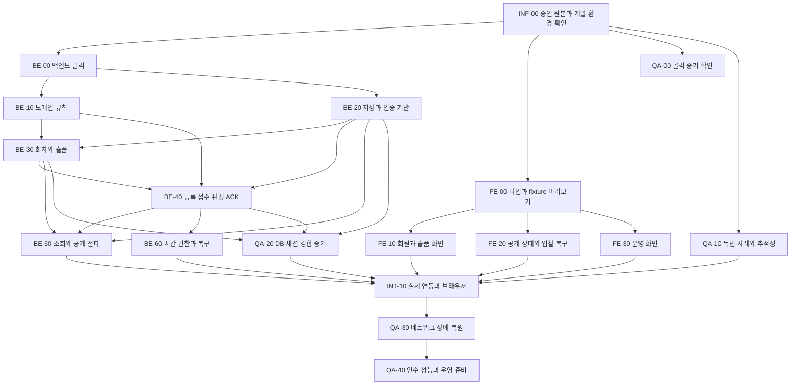

# IMPLEMENTATION PLAN — 승인 기준선의 병렬 구현 작업

## 1. 상태와 이번 작업 범위

| 항목 | 내용 |
| --- | --- |
| 작성일 / 문서 버전 | 2026-10-16 / 0.7 |
| 성격 | 구현 작업 분할·의존성·완료 조건. 새 제품 정책이나 계약의 원본이 아님 |
| 입력 기준선 | SYSTEM-DESIGN 1.0, DOMAIN-MODEL 1.2, 제품 1.6, DECISION-LOG 1.8, 공통 계약 0.1.0, D-095 |
| 현재 실행 범위 | M-01 공개 목록·페이지·상세·복귀/동일 화면 복구와 최종 문서 dev 통합 완료. 다음 M-02는 계정 정책·계약 구체화부터 준비하며 기능 구현 READY 아님 |
| 후속 기능 범위 | 아래 기능 카드는 계획이다. 이번 골격 생성만으로 구현·연동·제품 인수 완료 처리하지 않음 |
| 통합 기준 | 최신 `dev`에서 작업 브랜치 생성 → 검증/CI → `dev` 병합·푸시 → 완료 작업 브랜치 로컬·원격 삭제. `main` 병합은 사용자 주도로 별도 수행 |
| 현재 새 검증 | 공개 회차 조회의 실제 실행·관측·미실행은 [ROUND-DISCOVERY-VERIFICATION](ROUND-DISCOVERY-VERIFICATION.md) 참조. [Boot 전환](BOOT4-MIGRATION-VERIFICATION.md) 및 기존 정적 PASS·SPIKE 관측·후속 제품 인수와 구별 |
| 남은 결정 | 현행 OPEN, CR-04~10·SEC-01~04의 미승인 제안값, 미완성 전이/장애 메커니즘 유지 |

승인된 설계의 정의된 부분에서 작업을 시작한다. 전체 기능·추가 SPIKE·성능 실험 통과를 골격 작성의 선행조건으로 두지 않는다. 영향 경로에 남은 정책은 그 경로의 구현/인수 전에 결정하고, 기술 위험은 실제 구현과 함께 검증한다. 골격이나 fixture가 그 보장을 제공한다고 보고하지 않는다.

현재 작업 상태는 [STATE](../STATE.md), M-01 실행 기록은 [M-01 작업 운영안](../tasks/README.md)을 따른다. 전체 MVP의 순서·마일스톤·시작 조건은 승인된 [ROADMAP](../ROADMAP.md), Epic/Feature와 요구사항 전수 추적은 [BACKLOG](../BACKLOG.md)에 있다. 다음 별도 세션은 [M-02 리드 컨텍스트](../handoffs/M-02-LEAD-CONTEXT.md)를 따른다. M-01 T-001~004는 MERGED이며 당시 [M-01 인계](../handoffs/M-01-LEAD-CONTEXT.md)는 이력으로 보존한다. M-02의 미승인 CR-10/SEC 결정을 정리하고 ADR-005의 관련 계약 변경 승인·봉인 뒤 필요한 실행 카드를 구체화한다. 초기 구현 활성 최대 2명과 실제 착수 SHA·계약·worktree·선행 통합 증거를 고정한다. 장기 기능 카드 전체 완료나 후속 기능의 일괄 구현 착수로 확대하지 않는다.

## 2. 공식 원본과 작업의 공통 입력

| 사실 | 공식 원본 |
| --- | --- |
| 요구사항과 AC | [MVP-PRD](../product/MVP-PRD.md) |
| 업무 흐름 설명 | [AUCTION-RULES](../product/AUCTION-RULES.md) |
| 승인·미정 정책·위험 | [DECISION-LOG](../decisions/DECISION-LOG.md), 특히 D-095와 현재 OPEN |
| INV·TS·TV | [DOMAIN-MODEL](../architecture/DOMAIN-MODEL.md) |
| 모듈·계층·소유권·의존성·필수 업무 트랜잭션 | [SYSTEM-DESIGN](../architecture/SYSTEM-DESIGN.md), §3~§7 |
| 경로·요청/응답·오류·이벤트 payload·예제 | [OpenAPI](../../contracts/openapi.yaml) |
| SSE·순서·중복·재동기화 의미 | [auction-events](../../contracts/auction-events.md) |
| 승인 파일 식별 | [approved-baseline-0.1.0.json](../../contracts/approved-baseline-0.1.0.json) |
| 계약 변경 절차 | [ADR-005](../decisions/adr/ADR-005-CONTRACT-BASELINE.md) |
| QA의 증거 분류·우선순위·보류 사례 | [QA-PLAN](QA-PLAN.md) |
| 초기 골격의 실제 명령·결과·미실행 | [FOUNDATION-VERIFICATION](FOUNDATION-VERIFICATION.md). Maven으로 수행한 초기 통합 실행 이력 원본 |
| Gradle 전환의 실제 명령·결과·미실행 | [GRADLE-MIGRATION-VERIFICATION](GRADLE-MIGRATION-VERIFICATION.md). Spring Boot 3.5.16에서 수행한 빌드 도구 전환 이력 원본 |
| Spring Boot 4 전환 이력 | [BOOT4-MIGRATION-VERIFICATION](BOOT4-MIGRATION-VERIFICATION.md). 당시 전환 실행 결과 원본 |
| 현재 공개 회차 목록·상세 탐색의 실행 결과 | [ROUND-DISCOVERY-VERIFICATION](ROUND-DISCOVERY-VERIFICATION.md). DB·HTTP·브라우저와 미실행 범위 |

담당자는 같은 승인 manifest와 계약 버전을 입력으로 사용한다. 생성 타입·mock·화면 모델은 파생물이며 별도 계약 원본으로 취급하지 않는다. 일반 구현 담당은 `docs/product/**`, `docs/architecture/**`, `docs/decisions/**`, `contracts/**`를 임의 수정하지 않는다. M-02 준비 중 필요한 변경은 Contract Owner가 ADR-005의 구체 승인·봉인 절차를 거쳐 반영하며 이번 인계 문서 작업은 이 원본을 변경하지 않았다. 기존 검사 재실행 시 봉인된 결과 파일을 덮어쓰지 않고 구현 증거 위치로 출력한다.

## 3. 병렬 작업 DAG

아래 화살표는 구현 완료 의존성이다. 같은 계약을 읽는 관계는 화살표로 묶지 않는다. 정책 결정이나 기술 검증은 영향을 받는 경로의 조건이며 다른 작업을 일괄 중지시키지 않는다.

BE-50의 공개 DTO 매핑·SSE 어댑터, BE-60의 복구 포트, QA-20의 시험 설계는 선행 기능이 끝나기 전 승인 계약·포트와 test double로 작성할 수 있다. 다이어그램의 선행 조건은 실제 통합 완료 판정에 적용한다. FE-10/20/30도 실제 서버를 기다리지 않고 동일 계약의 mock으로 개발하며 mock 통과와 실제 연동을 별도로 기록한다.

## 4. 파일 소유 범위와 병렬화 규칙

| 담당 | 기본 편집 범위 | 다른 담당에게 제공할 산출물 |
| --- | --- | --- |
| BE | `backend/**` | 실행물·health 의미·공개 애플리케이션 포트·실제 HTTP 동작과 DB/세션 시험 증거 |
| FE | `frontend/**` | 생성 타입·계약 버전 식별·개발 전용 fixture·화면/상태 소비 코드·브라우저 증거 |
| 통합/인프라 | `infra/**`, `scripts/**`, 루트 개발 설정·실행 안내 | 로컬 의존 서비스·명령·환경 변수 예시·manifest 무결성 검사와 결과 |
| QA/검토 | 이 계획과 `QA-PLAN.md`; 후속 시험 코드·증거의 위치는 착수 시 소유자와 지정 | 독립 기대값·추적성·증거 목록·미검증/보류 사유 |
| 공식 상태·통합 결과 기록 / 리드 | `docs/STATE.md`, `docs/tasks/**`, 새 검증 보고서와 현재 가이드 | 구현자는 결과를 제출하고 리드만 검증된 상태를 반영. 기존 FOUNDATION·GRADLE·BOOT4·PUBLIC-ROUND 검증 보고서는 당시 이력으로 보존 |
| Contract Owner | 현재 봉인 원본은 읽기 전용 | 계약 불일치의 영향 판단·변경안·승인된 새 기준선 |

BE 카드들은 하나의 `backend/**` 소유 아래 순차 반영하거나, 기능별 패키지/시험 파일의 전담자를 정한 뒤 병렬화한다. 같은 설정·migration·원판정 저장소·공개 DTO 파일을 둘이 동시에 수정하지 않는다. FE의 생성 파일은 생성 명령만으로 변경하고 컴포넌트 담당자가 손으로 필드를 추가하지 않는다. 공통 설정 변경은 통합 담당에게 diff로 인계한다.

각 인계에는 카드 ID, 입력 기준선, 변경 파일, 소비할 인터페이스, 실행 명령/결과 위치, OPEN 영향, 미검증 범위를 포함한다. 파일 소유는 조정 규칙이며 새 모듈 의존성이나 업무 권한을 승인하는 근거가 아니다.

## 5. 현재 골격 작업 카드

### INF-00 — 재현 가능한 개발 진입과 승인 원본 보호

| 구분 | 내용 |
| --- | --- |
| 입력 | 승인 manifest, SYSTEM-DESIGN §13, BE/FE 실행 요구 |
| 출력 | 로컬 인프라 정의·환경 변수 예시·준비/실행/검증 명령·승인 파일 hash 확인 도구 |
| 의존성 / 소유 | 독립 착수. `infra/**`, `scripts/**`, 필요한 루트 설정 |
| DoD | 비밀 없는 예시 설정, 의존성 준비와 앱 실행 구분, 승인 파일 변경 감지 시 실패, 출력한 결과와 실제 실행 여부 기록 |
| 경계 | DB 컨테이너 기동은 migration·업무 트랜잭션·세션 저장 성공 증거가 아님. 스크립트 작성은 실행 성공과 구별 |
| 추적 | D-095, SYSTEM-DESIGN §3/4/13, ADR-005. 제품 AC 직접 통과 범위 없음 |

로컬 포트·볼륨 이름·개발 도구 버전은 실행 구성이다. 이를 제품 수용량·가입자 수·입력 상한·장애 감지 상한·운영 배포 승인으로 해석하지 않는다. 실제 생성한 파일과 명령의 사용법은 각 실행 안내가 원본이며 이 계획에서 복제하지 않는다.

### BE-00 — Java 25/Spring 백엔드 골격과 의존성 검사

| 구분 | 내용 |
| --- | --- |
| 입력 | SYSTEM-DESIGN의 `identity/listing/auction/query/realtime/bootstrap`, 계층·포트·조립 규칙 |
| 출력 | Java 25/Spring 실행 골격, 논리 패키지 경계, 운영용 health, 최소 실행/아키텍처 검사 |
| 의존성 / 소유 | INF-00의 실행 환경 확인. `backend/**` |
| DoD | 빌드와 검사 명령·도구 버전 기록, 도메인의 Spring/JDBC/HTTP 직접 의존 및 모듈 순환을 검사, health의 실제 응답과 검증 범위 기록 |
| 경계 | 운영 health는 업무 API나 입찰 접수 가능성 보증이 아님. DB/메일 미연결 골격 health를 전체 readiness로 표시하지 않음. 빈 패키지 검사 PASS는 향후 코드의 무순환 보장이 아님 |
| 추적 | D-095, SYSTEM-DESIGN §3/4. 후속 INV-15/23/29/44를 배치할 구조이며 해당 INV의 기능 통과를 주장하지 않음 |

아직 구현하지 않은 업무 경로에 가짜 `200`·`202`·승인 판정을 넣지 않는다. 선택한 정확 라이브러리 버전은 해당 빌드 파일과 lock/해석 결과에 기록하고 승인 기술 조합과의 호환성을 확인한다.

현재 백엔드 실행·빌드 기준은 Amazon Corretto 25·Spring Boot 4.1.1·Gradle Wrapper 9.8.1이며 빌드 선언은 Kotlin DSL이다. `backend/`에서 Windows는 `.\gradlew.bat --no-daemon clean build`, Unix는 `bash ./gradlew --no-daemon clean build`를 사용한다. 실행물은 `backend/build/libs/auction-platform-backend-0.1.0-SNAPSHOT.jar`이며 테스트 결과는 `backend/build/test-results/test/`와 `backend/build/reports/tests/test/`다. [backend 실행 안내](../../backend/README.md)의 공식 지원 범위와 실제 검증 구분을 따른다. 이번 Spring Boot 전환의 범위는 기존 골격의 호환성 적용과 검증이며 후속 기반·업무 기능 구현은 별도 카드로 진행한다.

### FE-00 — 계약 생성 타입과 개발 전용 fixture 미리보기

| 구분 | 내용 |
| --- | --- |
| 입력 | 계약 0.1.0의 OpenAPI·예제와 공개/개인 경계, 이벤트 의미 |
| 출력 | React/TypeScript 골격, 재생성 가능한 계약 타입, 고정 fixture 미리보기와 개발 전용 진입점 |
| 의존성 / 소유 | INF-00의 승인 원본 확인. 서버 완료에 의존하지 않음. `frontend/**` |
| DoD | 원본을 수정하지 않고 타입 생성·재생성 차이 확인, 타입 검사/빌드 결과, 금액·version 문자열 보존, fixture의 개발 전용 표시/실제 서버와의 구별 |
| 경계 | fixture 전환·정적 화면은 입찰·인증·SSE·재접속 성공 증거가 아님. 실제 이메일·비밀번호를 포함하지 않음. 미정 제한을 화면 validation으로 채우지 않음 |
| 추적 | AC-R38-03, AC-R46-03; INV-06/26; TS-04/30의 표현 확인 준비. 실제 업무/권한 통과와 구별 |

fixture는 공개 허용 필드와 계약에 정의된 상태만 쓴다. 유찰 결과에는 최고입찰가를 더하지 않으며, 이를 이유로 본인 원입찰을 삭제하는 동작을 만들지 않는다. 모바일 배치·자동 결과 표시 시간은 OPEN-08의 제품 결정을 대신하지 않는다.

### QA-00 — 이번 골격의 독립 증거 확인

| 구분 | 내용 |
| --- | --- |
| 입력 | INF-00/BE-00/FE-00의 변경 파일·명령·검증 결과와 승인 manifest |
| 출력 | [QA-PLAN](QA-PLAN.md)의 초기 범위별 결과·증거 링크·미실행 사유 |
| 의존성 / 소유 | 사례 작성은 독립 착수. 결과 판정은 각 실제 실행 후. `docs/implementation/**` |
| DoD | 원본 hash 불변, BE 빌드/아키텍처와 실행 health, FE 타입/빌드와 실제 미리보기 관측을 서로 구분하고 실행하지 않은 항목은 NOT_RUN 유지 |
| 경계 | 이 카드 완료는 52개 요구사항·136개 AC의 제품 인수 통과가 아님. 소스/설정 검토와 브라우저 관측을 섞지 않음 |
| 추적 | D-095, ADR-005. 제품 AC의 직접 PASS는 해당 기능 증거가 있을 때만 별도 판정 |

## 6. 후속 BE 기능 카드

아래 DoD는 미래 완료 조건이다. 전부 **PLANNED / NOT_RUN**에서 시작한다. 상세 정책이 필요한 필드만 보류하고, 승인된 불변식의 구현·단위 사례 작성은 계속할 수 있다.

| 카드 / 소유 | 입력 → 출력 | 선행·병렬 조건 | AC·INV·TS 연결 | DoD와 남은 경계 |
| --- | --- | --- | --- | --- |
| BE-10 / BE 도메인 | 승인 불변식·시각 맥락 → 순수 도메인·유효 전이·명확한 거절 | BE-00 이후. BE-20과 병렬 | AC-R08-01, AC-R10-01, AC-R21-03, AC-R46-03; INV-06/10~16/22/23; TS-01~13 | 정확한 버튼 금액·최고가/결과 일관성·현재 마감·거절 무변경을 독립 기대값으로 검증. 합성 시각 통과를 실제 S/N/R 보장으로 확대하지 않음 |
| BE-20 / BE 기반 | 인증/권한 계약·같은 DB 원칙 → identity와 저장/트랜잭션·행위자 경계 | BE-00 이후. 미정 보안 수명·계정 동일성 경로는 OPEN-06 대기 | AC-R45-01, AC-R50-01, AC-R52-01, AC-R52-02; INV-10/27; TS-05/31 | 실제 PostgreSQL·세션·쿠키/CSRF·당사자 범위의 별도 증거. 운영자에게 회원 역할/포괄 조회를 부여하지 않음 |
| BE-30 / BE 회차·출품 | 일정/등록/공개 계약 → 모집·Lot·배정·공개 Auction·회차 시작/취소 | BE-10/20. listing 공개 포트와 auction 조정, 동일 업무 tx | AC-R28-02, AC-R28-03, AC-R30-03, AC-R34-03, AC-R41-02, AC-R41-03; INV-03~09/47~51; TS-24~29/71~82 | 회차/일정 보호·공개 직전 요청·배정 순번·취소 미진행 표시·동시 완료를 검증. OPEN-01/05 입력값과 파일 제한은 임의 설정하지 않음 |
| BE-40 / BE 입찰 | 등록/제출/조회/ACK·명령 계약 → 원키·내구 접수·순번 판정·원결과·outbox | BE-10/20/30. 실제 원자성은 DB 검증 필요 | AC-R21-01, AC-R21-05, AC-R23-02, AC-R23-03, AC-R23-10, AC-R23-12; INV-13~19/29~32/42~46; TS-10~16/41~48/63~70 | 등록≠접수≠판정≠ACK, 동일 키 경합·원판정 불변·rollback/commit 불명·옛 ACK를 검증. Round 순서와 Lane 순서를 각각 확인하며 HTTP 도착순을 약속하지 않음 |
| BE-50 / BE 조회·전파 | 권한별 DTO·outbox·snapshot → 공개/본인 조회·SSE 재생/복구 | 순수 DTO·전송은 조기 병렬. 실제 상태 통합은 BE-30/40 이후 | AC-R02-01, AC-R38-03, AC-R39-01, AC-R51-01; INV-18/26/27; TS-30/31/32 | 동일 snapshot/watermark·scope/세대·중복/gap·마지막 유실·private REST 복구 검증. OPEN-07의 필드/관리 조회와 OPEN-10/12 재생 수치는 추가하지 않음 |
| BE-60 / BE 진행·복구 | ADR-001~003·권한 기록 → 실제 전이·old tx 차단·보류/확인/재개 | 인터페이스/증거 설계는 조기 병렬. 실제 집행은 BE-20/40과 통합 | AC-R21-09, AC-R21-11, AC-R24-03, AC-R24-04, AC-R24-05, AC-R26-09; INV-20/21/33~43; TS-49~65; TV-08/10 | 실제 S/N/R·추가 commit 간격·입찰 접수 연속성·권위 선후·원 R 복구 증거. B 후보는 미완성이고 단일 앱/flag만으로 안전성 PASS를 선언하지 않음 |

## 7. 후속 FE·QA·통합 카드

| 카드 / 소유 | 입력 → 출력 | 선행·병렬 조건 | AC·INV·TS 연결 | DoD와 남은 경계 |
| --- | --- | --- | --- | --- |
| FE-10 / FE 회원·출품 | 생성 타입·mock → 회원/로그인·출품·본인 목록·당사자 연락처 화면 | FE-00 이후, 서버와 독립. 실제 인증은 BE-20/30/50 연동 | AC-R35-01, AC-R45-01, AC-R46-03, AC-R50-01, AC-R51-01, AC-R52-02; INV-06/26/27; TS-04/30/31 | 양의 금액·비정렬 최저가와 권한 분기 일치. OPEN-05/06/07 미정 validation·권한·계정 정책은 임의 확정하지 않음 |
| FE-20 / FE 공개·입찰 | 이벤트/입찰 계약·mock → 4레인 표시·등록/접수/판정/ACK·snapshot 복구 | FE-00 이후. BE-40/50과 인터페이스만 공유 | AC-R04-01, AC-R23-07, AC-R23-10, AC-R23-12, AC-R38-03; INV-01/18/19/26/44/45; TS-15/16/23/30/66~69 | 같은 원키·금액 유지, 확인 중을 실패로 표시하지 않음, scope별 순서/중복/gap·개인 결과와 공개 상태 분리. 로컬 0초로 결과 확정하지 않음 |
| FE-30 / FE 운영 | 운영자 계약·mock → 회차·중단/재개·취소·복구 확인 화면 | FE-00 이후. 실제 동작은 BE-30/40/60과 연동 | AC-R25-02, AC-R26-08, AC-R26-09, AC-R41-03, AC-R52-01; INV-21/24/42/43/49; TS-21/63~65/75~78 | 원명령/발생 건 보존, 확인≠재개, 회차 취소≠상품 유찰. 미정 관리 조회와 모바일 운영자 기능 추가하지 않음 |
| QA-10 / QA 사례 | 승인 AC/INV/TS·계약 예제 → 독립 사례·반례·증거 양식 | INF-00 이후 BE/FE와 병렬 | TS-01~83, TV-01~10에서 위험별 선택; 상세는 QA-PLAN | 구현의 조건문을 복사하지 않고 승인 결과를 기대값으로 사용. 미정은 조건부/보류, 통과율 분모에서 숨기지 않음 |
| QA-20 / QA DB·세션 | BE 실행물·DB/세션 구성 → 동시성·atomicity·인증/권한 증거 | BE-20/30/40 기능별 조기 수행 | AC-R21-01, AC-R23-02, AC-R24-04, AC-R45-01, AC-R52-02; INV-15/18/19/27/39/44; TS-14~16/31/60/66~70 | 실제 DB 변경·commit 경계와 브라우저 세션을 관찰. health나 mock을 트랜잭션/권한 성공으로 대체하지 않음 |
| INT-10 / 통합+BE/FE/QA | 같은 계약 버전의 실제 앱 → HTTP/SSE·브라우저 수직 흐름 | 기능별 BE/FE 준비, OPEN-08 대상 환경 합의 | AC-R38-03, AC-R47-01, AC-R49-04; INV-26/27/44/45; TS-30/31/66~69 | 등록→접수→원판정→ACK·조회·운영 경로를 같은 빌드로 검증. mock 증거와 실제 서버 증거 구별 |
| QA-30 / QA 네트워크·장애 | 실제 앱/DB·진행 권한·결함 주입 → 단절/재생/old tx/복구 증거 | INT-10, BE-60. 시나리오별 OPEN-09/10 상세화 | AC-R24-01~05, AC-R26-09, AC-R49-03/04; INV-18~21/37~43; TS-57~65; TV-03/04/08~10 | 응답·SSE 단절과 admission 장애 구별. 불명 추정 종료·자동 재개·옛 명령 효과 없음. 주입한 장애와 미관측 범위 기록 |
| QA-40 / QA 인수+운영 검토 | 통합 실행물·합의 시험 조건 → 기능/지연/정확성 결과·운영 미비 목록 | QA-30, OPEN-08/13 및 운영 관련 OPEN의 해당 판단 | AC-R48-01, AC-R49-01~04; TV-06/07 | 4레인·100연결·20/80 기본 구성/집중 부하 분리, 표본/실패 처리와 측정 경계 고정. 목표 달성·실제 운영 준비를 각각 판단 |

QA-10의 전체 TS 참조는 이번에 83개를 자동화한다는 범위 선언이 아니다. 각 실행 카드에서 선택한 사례와 미선택 사례를 남기고, 전체 제품 인수 판단 때 요구사항·제외 조건의 누락을 대조한다.

## 8. 정책 결정과 기술 검증의 작업 처리

| 조건 | 계속할 수 있는 작업 | 해당 경로에서 보류할 것 |
| --- | --- | --- |
| OPEN-01/05 | 일정 관계·양의 정수·정확 버튼 금액·비정렬 최저가·필수 사진의 승인 의미 | 미래 일정 범위/정밀도·금액/시간 상한·단위 후보·문자/사진 제한값 |
| OPEN-06 | 정의된 역할·세션/CSRF wire·원키 복구와 권한 반례 작성 | 동일 이메일 판정·세션/토큰 수명·비밀번호 수치·재설정 후 세션 정책 등 미정 보안 조건 |
| OPEN-07 | 공개 상태·유찰 최고가 미노출·본인 기록/당사자 경계 | 낙찰자 식별 상세·개별 이력 범위·추가 운영자 정보 접근·deferred 응답 |
| OPEN-08/13 | 합성 fixture·단위/DB 사례·측정 도구 작성 | 브라우저 지원 인수·결과 표시 시간·합의 전 성능 PASS |
| OPEN-09/10·미완성 시간/권위 메커니즘 | 승인된 의미의 포트·원자성/순서 설계·구현과 필요한 실행 검증 | 실제 S/N/R·내구성·old tx·복구 성공을 증거 없이 보장했다는 판정 |
| OPEN-12/14 | MVP 원기록 보호·자동 만료 없음·외부 거래와 경매 결과 분리 | 운영 보존/삭제·추가 개인정보 접근·실거래 운영 준비 완료 |

`BLOCKED_POLICY`는 정책 빈칸 때문에 해당 기대값/동작을 정할 수 없는 경우에만 쓴다. `NOT_RUN`은 미실행, `FAIL`은 실행한 기대값 위반이다. 미완성 구현·실행 검증 필요를 모두 제품 정책 미정으로 바꾸지 않는다. 추가 SPIKE만이 유일한 해결 방법인 것처럼 강제하지 않는다.

## 9. 공통 DoD와 변경 절차

1. 카드에 입력 승인 버전·수정 범위·소비할 포트·연결 AC/INV/TS·OPEN을 적는다.
2. 도메인 규칙은 도메인, use case·동일 DB 원자성은 애플리케이션, DB/HTTP/SSE는 어댑터에 배치하고 SYSTEM-DESIGN의 의존성 규칙을 검사한다.
3. 해당 위험을 확인하는 검사만 실행하고 명령·실행 환경·대상 commit/dirty diff·결과·미실행 범위를 남긴다. 테스트 수가 제품 AC 통과 수를 대신하지 않는다.
4. 생성 타입·예제·mock·서버·소비자의 계약 버전을 맞추고 공개/개인 필드·원접수/원판정/ACK·중복/복원 의미를 대조한다.
5. 계약 변경이 필요하면 관련 R/D/INV, 정확 diff·예제·호환성·BE/FE/QA 영향을 Contract Owner에게 제출한다. [ADR-005](../decisions/adr/ADR-005-CONTRACT-BASELINE.md)의 검토·사용자 승인·새 기준선 절차 전에 원본이나 구현에서만 의미를 바꾸지 않는다.
6. 승인 파일 hash 불일치는 검사 실패로 보고 원인을 확인한다. 새 hash를 자동 승인하거나 기존 sealed manifest를 덮어써 통과시키지 않는다.
7. 기능 완료, 트랜잭션/세션 완료, 장애/재접속 완료, 브라우저 완료, 성능 달성, 실제 운영 준비를 각각 증거로 판정한다.
8. 검증된 작업을 최신 `dev`에 통합·푸시하고, 원격 `dev`가 로컬·원격 작업 tip을 모두 포함함을 확인한 뒤 해당 작업 브랜치를 삭제한다. 미병합 작업·다른 worktree의 브랜치·상시 브랜치 `main`/`dev`는 보존한다. 검증 커밋·통합 커밋·CI·정리 결과를 보고하고 checkout은 `dev`에 둔다. `main` 승격은 사용자가 별도로 수행하며 일반 작업 완료 조건에 포함하지 않는다. 상세 규칙은 [AGENTS.md](../../AGENTS.md)를 따른다.

## 10. 이번 실행 결과와 인계

현재 공개 회차 목록·상세 탐색의 실행 상태·정확 명령·환경·관측·미실행은 [ROUND-DISCOVERY-VERIFICATION](ROUND-DISCOVERY-VERIFICATION.md)이 원본이다. 초기 Maven·Gradle·Boot 전환 기록은 각 과거 검증 보고서에 보존한다. 작업별 현재 상태는 [STATE](../STATE.md)에서 리드가 관리한다. [M-01 작업 기록](../tasks/README.md)은 실제 착수·검증·통합을 기록한다. T-004 문서의 최종 dev 통합과 해당 CI는 현재 STATE에 확인 근거를 반영했다. 기존 후속 기능 묶음의 PLANNED / NOT_RUN은 개별 카드의 승인·실행·검증 상태를 대신하지 않는다.

결과 원본에서는 실행한 대상만 갱신한다. `scripts/check-approved-baseline.py`의 해시 확인, `scripts/verify-contracts.py`의 임시 복사 검사, `scripts/verify.ps1`의 빌드 확인과 실제 앱/브라우저 관측은 각각 판정한다. 로컬 인프라·JDBC 연결·health·개발 미리보기의 관측을 제품 인증 세션·입찰·경합·재접속·장애·성능 인수 통과로 확대하지 않는다. 승인 원본의 과거 NOT_RUN/PASS 기록도 소급 수정하지 않는다.

공개 상세만 수행한 이전 실행은 [PUBLIC-ROUND-VERIFICATION](PUBLIC-ROUND-VERIFICATION.md)에 그대로 보존한다. 0.6은 M-01 실행 안내를 반영했고 이번 0.7은 M-02 인계와 M-01 최종 완료 안내를 반영했다. 제품/설계/계약 기준선·후속 QA 승인 범위는 변경하지 않았다.
