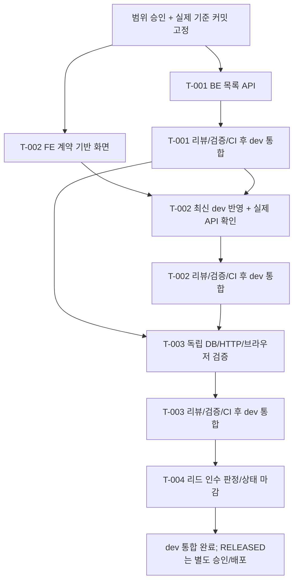

# M-01 — 공개 회차 탐색 작업 운영안

상태 **범위 승인 완료 / 작업 카드 DRAFT·실행 준비 대기**, 작성일 2026-10-16, 책임 Engineering Lead. 공식 작업 상태는 [STATE](../STATE.md)가 관리한다. 전체 로드맵과 첫 M-01 실행 범위에 사용자가 “승인”으로 답했으며 실제 착수 조건은 별도 확인한다.

전체 MVP에서의 위치·선행/후속 마일스톤·위험 검증은 승인된 [ROADMAP](../ROADMAP.md), 기능 추적은 [BACKLOG](../BACKLOG.md)를 참조한다. 별도 세션은 [M-01 실행 리드 컨텍스트](../handoffs/M-01-LEAD-CONTEXT.md)에서 시작한다. T-001~004는 담당·실제 SHA·worktree·환경/선행 확인 전이므로 DRAFT이며, 같은 범위 승인을 반복 요청하지 않는다.

## 목표와 범위

비회원이 `/`에서 공개 회차를 보고, 다음 페이지를 탐색하고, 선택한 회차의 기존 상세 화면으로 이동한다. 빈 목록·조회 실패·재시도·돌아오기도 구분한다. 사용자가 ID가 담긴 외부 링크를 먼저 받아야 하는 현재 진입 제약을 해소한다.

사용하는 계약은 `GET /api/v1/rounds`의 `listPublicRounds` / `PublicRoundPage`와 기존 `getPublicRound` / `PublicRoundState`다. 목록은 `scheduledStartsAt`, `roundId` 오름차순이며 `nextCursor=null`이 끝이다. 페이지 사이 데이터 변경 중 완전히 고정된 목록을 보장하지 않는다는 계약 경계를 유지한다.

기존 BE-50의 BE-30/40 선행조건이 필요한 상태 생성·입찰 전파는 이 작은 읽기 작업에 포함하지 않는다. 이미 존재하는 V1과 공개 사실을 조회하므로 이 작업의 완료가 그 선행 기능의 완료를 대신하지 않는다. 입찰·실시간 4레인·상품 목록/사진·로그인·운영자 회차 생성·공개/시작 명령은 후속 범위다. DB 입력은 기존 저장 모델을 사용하는 명시적 합성 시험 데이터다. 목록 조회가 회차를 생성·공개하거나 시각으로 상태를 바꾸지 않는다.

| 후보 | 사용자 가치 | 선행 부담 | 판단 |
| --- | --- | --- | --- |
| 공개 회차 목록 → 기존 상세 | 링크를 받지 않아도 공개 회차 발견 | 기존 rounds 테이블/조회 경계 재사용, 승인 API 정의됨 | 이번 최소 흐름으로 추천 |
| 이메일 인증 계정의 로그인 → 세션 확인 → 로그아웃 | 회원 기능의 입구 | 실제 identity·계정 준비·세션/CSRF 저장 및 OPEN-06/CR-10/SEC 결정 | 다음 정책 결정 후 별도 마일스톤 |

## 공통 입력과 출발 기준

| 입력 | 버전·역할 |
| --- | --- |
| [AGENTS](../../AGENTS.md) | 조사 커밋의 작업/통합 규칙 |
| [STATE](../STATE.md), [IMPLEMENTATION-PLAN](../implementation/IMPLEMENTATION-PLAN.md), [QA-PLAN](../implementation/QA-PLAN.md) | 리드의 상태, 현재 0.5 계획·증거 분류; 이 작업 세분화와 함께 읽음 |
| [MVP-PRD](../product/MVP-PRD.md), [AUCTION-RULES](../product/AUCTION-RULES.md) | 1.6, R-37/AC-R37-01의 공개 접근 일부 및 R-47의 개발 화면 확인 |
| [DOMAIN-MODEL](../architecture/DOMAIN-MODEL.md) | 1.2, INV-26의 공개 정보 보호 경계. 전체 상품/실시간 AC의 완료를 주장하지 않음 |
| [SYSTEM-DESIGN](../architecture/SYSTEM-DESIGN.md), [MODULE-BOUNDARIES](../../backend/MODULE-BOUNDARIES.md) | 1.0 및 현재 코드 경계, auction 소유 records/query 읽기 SQL projection |
| [DECISION-LOG](../decisions/DECISION-LOG.md), [ADR-005](../decisions/adr/ADR-005-CONTRACT-BASELINE.md) | 1.8, D-095·OPEN·계약 변경 절차 |
| [OpenAPI](../../contracts/openapi.yaml), [auction-events](../../contracts/auction-events.md) | 계약 0.1.0, 이벤트 schemaVersion 1. M-01은 SSE 미사용, 목록 커서를 stream 커서와 혼용하지 않음 |
| [승인 manifest](../../contracts/approved-baseline-0.1.0.json) | strict-evidence PASS 필수, 해시 재봉인 금지 |
| [공개 상세 검증](../implementation/PUBLIC-ROUND-VERIFICATION.md) | 기존 기능 회귀 근거; 새 목록 기능의 PASS 근거로 사용하지 않음 |

조사·설계 기준 커밋은 `e5ebde892395c02bae9f4e604b610a4bf7088ee0`다. **실제 구현 시작 커밋은 아직 없다.** DRAFT 카드의 미배정은 의도적이며 READY 전에 반드시 실제 SHA로 채운다. 승인 후 fetch한 최신 `origin/dev`에서 T-001/T-002를 분기한다. 계획 문서 통합 등으로 tip이 이동했다면 위 조사 SHA를 착수 SHA로 복사하지 않는다.

리드는 `git fetch origin --prune`, `git rev-parse origin/dev`, strict-evidence, `git worktree list`, `git merge-base --is-ancestor <dependency-sha> origin/dev`를 확인하고 실제 SHA·계약 0.1.0·담당·worktree를 각 카드에 기록한다. 후속 작업에 `최신`, `완료 예정`, 작업명만 인계하지 않는다.

## 의존성 그래프와 배정



| 단계 | 슬롯 A | 슬롯 B | 실제 시작 조건 |
| --- | --- | --- | --- |
| 현재 | 구현 미배정 | 구현 미배정 | 범위 승인·인계 작성 완료. 카드 DRAFT, 실제 READY 조건 확인 전 |
| 1 | T-001 / BE A | T-002 / FE B, 계약 mock 개발 | 승인 + 같은 실제 origin/dev SHA + 별도 worktree |
| 2 | T-001 리뷰·검증/통합 | T-002 최신 dev 반영·실제 API 확인 | T-001 검증·통합 SHA 인계. FE mock 완료 보고로 서버 연동 완료 판단 금지 |
| 3 | T-003 / QA·통합 C | 신규 구현 배정 없음 | T-001/T-002 tip이 origin/dev에 포함되고 통합 CI 성공 |
| 4 | T-004 / 리드 | 수정 필요 시 원담당 1명만 재배정 | T-003 증거/실제 통합 SHA. 리드는 구현 수정 대신 재작업 지시 |

T-003의 독립 기대값 검토는 미리 읽기 전용으로 할 수 있으나 코드 작성·실행 배정은 단계 3부터다. 구현 활성 상한은 항상 2명이며, 같은 파일 소유자 교체는 종료/인계 확인 후에만 한다.

## 충돌 위험과 변경 소유권

| 영역 | 단일 소유자 | 위험과 처리 |
| --- | --- | --- |
| `contracts/**`, 승인 제품/설계/결정 파일 | Contract Owner | 읽기 전용. 의미 변경 필요 시 ADR-005, 사용자 승인 후 새 기준선 배정 |
| `backend/**`의 query·HTTP·security/bootstrap 및 해당 테스트 | T-001 BE A | 기존 상세 controller/보안 조립과 충돌 가능. BE 담당 1명, 익명 목록 GET만 추가, 인증 구현 확대 금지 |
| `backend/build.gradle.kts`, locks, application 설정, `db/migration/**` | 단계 1~2 BE A가 조정, 기본 변경 잠금 | 이번 목록은 V1 재사용, migration/의존성 추가 예상 없음. 필요 발생 시 리드가 범위를 재배정. V1 수정 금지 |
| FE App·CSS·rounds·package/lock·기존 E2E | T-002 FE B | FE 담당 1명. 생성 타입 수동 수정 금지. 기존 상세 회귀 E2E 수정도 이 담당만 수행 |
| `scripts/**`, `.github/**`, `infra/**`, 새 `frontend/e2e/round-discovery.spec.ts` | 단계 3 T-003 QA/통합 C | 단계 1~2 변경 잠금. FE/BE는 요청만 제출. T-002 종료·소유권 인계 후 시험 harness/fixtures 수정 |
| `docs/STATE.md`, `docs/tasks/**`, 현재 계획/가이드·공식 검증 보고서 | Engineering Lead | 다른 구현자는 제출물만 작성, 상태·승인·공식 결과 직접 수정 금지 |

공통 오류·로그·보안 설정은 새 목록을 연결하는 최소 변화만 T-001에 허용한다. API 계약, 실제 인증 정책, 공통 DB schema는 이번 작업에서 새로 정하지 않는다. 물리적 파일 분리가 성립해도 공통 DTO 의미가 바뀌면 계약 검토를 거친다.

## 통합 순서와 마일스톤 인수

통합 예상 순서: **T-001 → T-002 → T-003 → T-004**. 각 코드 작업은 독립 리뷰, 해당 검증, 커밋별 CI를 통과한 뒤에만 dev로 보낸다. T-002를 최신 dev와 합친 후보에서도 검증하며 T-003을 미리 시작해 성공을 가정하지 않는다.

최종 인수에는 공개 목록 필터·정렬·다음 페이지·빈 결과·opaque ID/큰 counter/시각 보존, 선택→기존 상세→목록 복귀, DB 중단 시 503/화면 구분, **동일 오류 화면에서 사용자가 재시도해 복구**하는 실제 관측이 필요하다. 공개 전 데이터와 private 필드가 응답/화면에 없어야 한다. 자동 상태 전이·SSE·세션 복구 주장은 제외한다.

브라우저는 Chromium 1280/390을 개발 검증안으로 제시하며 OPEN-08의 전체 지원 인수와 구별한다. 다른 환경 승인이 없다면 실제 관측 조건만 기록하고 R-47 전체 PASS나 RELEASED로 올리지 않는다.

## 공통 검증·제출·중단 규칙

명령은 저장소 루트 기준이다. `AUCTION_JAVA_HOME`은 담당자가 확인한 Corretto 25 경로를 런타임으로 주입한다. 가상환경 Python에는 `contracts/requirements-validation.txt`를 설치한다.

```powershell
python -X utf8 scripts/check-approved-baseline.py --strict-evidence
pwsh -NoProfile -File scripts/verify.ps1 -JavaHome $env:AUCTION_JAVA_HOME
pwsh -NoProfile -File scripts/verify.ps1 -JavaHome $env:AUCTION_JAVA_HOME -Integration
git diff --check
```

Docker 없는 DB/통합 검사는 실패/NOT_RUN 사유이며 PASS로 건너뛰지 않는다. 현재 명령의 기존 상세 시험만 통과해도 새 목록의 증거가 자동으로 생기지 않는다. 각 카드가 요구하는 새 사례를 추가하고 실행된 시험 이름·artifact를 제출한다.

제출에는 작업 ID, 입력/검증/통합 SHA, 계약 버전, 변경 파일, 공개 인터페이스, 실제 명령·exit code·도구 환경·결과 경로, FAIL/NOT_RUN, 잔여 OPEN을 포함한다. 기본 artifact 위치는 `.artifacts/tasks/T-xxx/<run-id>/`이며 CI가 이를 보존하도록 T-003이 확인한다. 원시 로그/자격정보를 Git에 넣지 않고 리드는 비밀 없는 요약과 CI artifact 링크를 새 보고서에 기록한다.

검증/CI 통과 후 최신 dev에 FF 또는 일반 merge로 통합·푸시한다. fetch 후 로컬/원격 작업 tip이 모두 `origin/dev`의 조상인지 확인하고 다른 worktree 사용 여부를 검사한 뒤 완료 브랜치만 삭제한다. main/dev와 미병합 커밋은 보존한다. 실패 시 원인·남은 작업을 기록하고 원담당에게 재배정한다.

승인 hash 불일치, 범위 밖 공통 파일 변경, 정책 빈칸의 임의 값 확정, private 정보 노출, 실제 의존 SHA 부재, 미통과 CI, 시험 인프라의 개발/운영 DB 접근 가능성이 발견되면 영향 작업을 중단해 리드에게 보고한다. 보고에는 재현·영향·차단 범위·필요 결정·재개 조건을 포함한다. 관련 없는 독립 작업은 계속할 수 있다.
